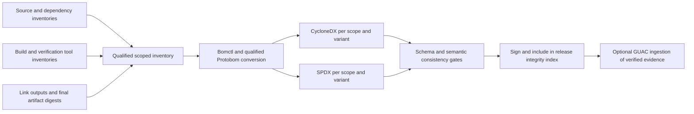
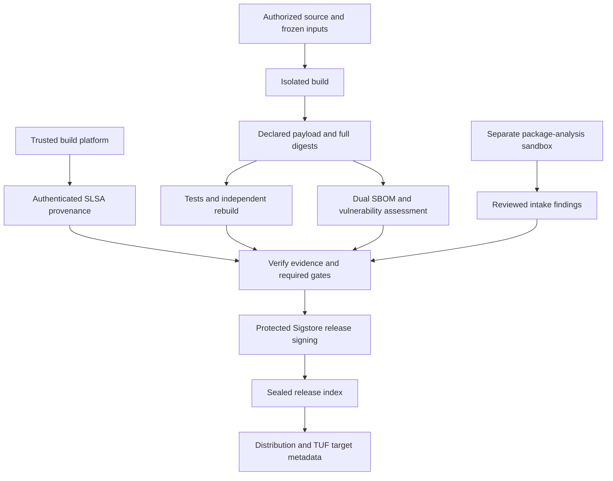
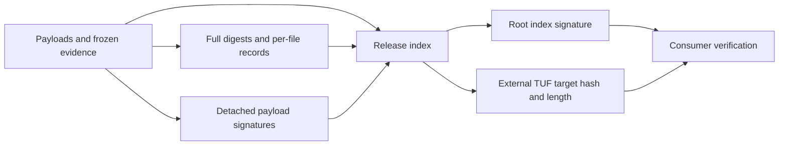
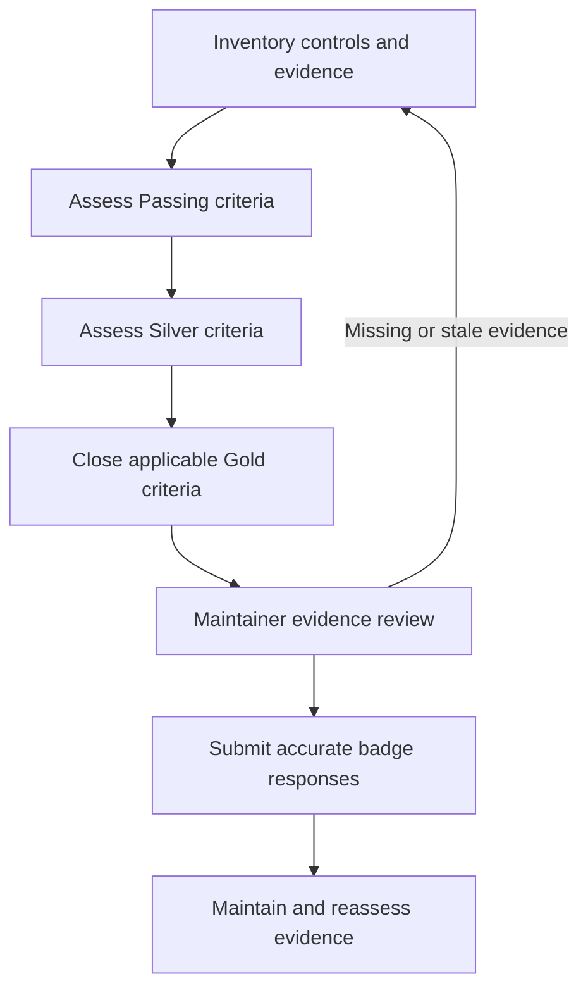

<!--
SPDX-FileCopyrightText: 2026 Rafael V. Volkmer <rafael.v.volkmer@gmail.com>
SPDX-License-Identifier: GPL-3.0-only
-->

# OpenSSF security and Gold badge plan

Gold is the project's target for the
[OpenSSF Best Practices Badge](https://openssf.org/projects/best-practices-badge/).
This document is an implementation and evidence plan, not a badge application,
certification, or statement that the project has earned a badge. The current
repository contains policy and CI checks, but no qualified allocator release.
The [implemented release fixture](../runbooks/release-fixture.md) now exercises Lua
integrity checks, dual SBOMs, provenance records, signatures, and Conan packaging.
Its explicit mock status preserves the distinction from production qualification.

Use the [service bootstrap guide](../runbooks/security-services.md) for the twenty-project
Actions matrix, the public project ID, GitHub Secrets, trust-root setup, and
adapters that still require qualification. A matrix entry is not proof that its
upstream tool ran; inspect the retained status and scope.

<details>
<summary><strong>On this page</strong></summary>

- [Programs and their boundaries](#programs-and-their-boundaries)
- [OSSF-001: Evidence and honest status](#ossf-001)
- [OSSF-002: Passing and Silver prerequisites](#ossf-002)
- [OSSF-003: Gold criteria map](#ossf-003)
- [OSSF-004: Contribution and access controls](#ossf-004)
- [OSSF-005: Product verification](#ossf-005)
- [OSSF-006: Release and supply-chain controls](#ossf-006)
- [OSSF-007: Vulnerability handling](#ossf-007)
- [OSSF-008: Supporting security tools](#ossf-008)
- [OSSF-009: OpenSSF adoption map](#ossf-009)
- [OSSF-010: Build identity and release layout](#ossf-010)
- [OSSF-011: Dual SBOM and material inventory](#ossf-011)
- [OSSF-012: Provenance, attestations, and signing](#ossf-012)
- [OSSF-013: Integrity and consumer verification](#ossf-013)
- [OSSF-014: Test logs and promotion evidence](#ossf-014)
- [OSSF-015: Integration order and release gates](#ossf-015)
- [Compliance stages](#compliance-stages)
- [Evidence record template](#evidence-record-template)
- [References](#references)

</details>

---

## Programs and their boundaries

The Best Practices Badge uses Passing, Silver, and Gold levels, with higher
levels depending on the preceding level. Use the official questionnaire and
its applicability rules when submitting evidence. A local summary cannot
award the badge. See the
[criteria discussion](https://www.bestpractices.dev/en/criteria_discussion).

| Program | Purpose here | Does not establish |
| --- | --- | --- |
| [Best Practices Badge](https://www.bestpractices.dev/en/criteria) | Project-wide practice and evidence assessment, targeting Gold | Absence of vulnerabilities |
| [OpenSSF Scorecard](https://scorecard.dev/) | Automated signals about repository practices | Gold status or a complete security review |
| [OSPS Baseline](https://baseline.openssf.org/) | Additional maturity-based security controls | An automatic mapping from its levels to badge levels |
| [SLSA](https://slsa.dev/spec/v1.2/) | Build and provenance assurance requirements | Reproducible bytes, code correctness, or Gold status |
| [Sigstore](https://docs.sigstore.dev/cosign/verifying/verify/) | Signature verification against identity and artifact policy | Trustworthiness of every signed input |

Scorecard scores, baseline maturity, and SLSA levels have separate criteria.
Do not describe a favorable scanner result as Gold. Record the applicable
official criteria in the evidence system when assessing conformance.

---

<a id="ossf-001"></a>

## OSSF-001: Evidence and honest status

**Class:** GOVERNANCE. **Obligation:** project requirement.

Every assessment must name an accountable role, the applicable criterion,
public evidence where safe, a verification method, remaining work, and an
acceptance decision. Use `MET`, `PARTIAL`, `MISSING`, or `NOT_APPLICABLE` with a
reason. These are local tracking states, not a substitute for the badge site's
response options. A missing implementation is not automatically inapplicable.

Do not count a policy file as proof that its process is followed. Do not count
a successful sample build as product coverage. Keep private vulnerability
details out of public evidence and publish a redacted process record instead.

The applicable SDD boundaries are
[build integrity](../specs/libmemalloc-security-SDD.md#lma-sec-010),
[instrumentation](../specs/libmemalloc-security-SDD.md#lma-sec-011), and
[test gates](../specs/libmemalloc-tests-SDD.md#lma-test-012).

---

<a id="ossf-002"></a>

## OSSF-002: Passing and Silver prerequisites

**Class:** GOVERNANCE. **Obligation:** project requirement.

Assess every applicable [Passing criterion](https://www.bestpractices.dev/en/criteria/0)
and [Silver criterion](https://www.bestpractices.dev/en/criteria/1) before closing
the Gold assessment. This guide's summaries are navigation aids, not an
exhaustive replacement for either questionnaire.

For this repository, review licensing, contribution guidance, public change
tracking, release identification, reporting channels, build instructions,
automated tests, compiler warnings, and security analysis first. Then examine
governance continuity, role assignments, architecture and security documentation,
dependency monitoring, regression practice, release signing, and an assurance
case that connects threats to implemented controls and evidence.

[GOVERNANCE.md](../../GOVERNANCE.md), [SECURITY.md](../../SECURITY.md),
the [C guides](../standards/c/README.md), and the CI configuration provide starting
material. They do not demonstrate contributor independence, protected branches,
account security, product coverage, or signed releases. Those need separate
evidence from maintainers and actual executions.

---

<a id="ossf-003"></a>

## OSSF-003: Gold criteria map

**Class:** GOVERNANCE / VERIFICATION. **Obligation:** project requirement.

Use the [official Gold criteria](https://www.bestpractices.dev/en/criteria/2)
and [their explanations](https://www.bestpractices.dev/en/criteria/2?details=true&rationale=true)
for the exact obligations and allowed applicability decisions. The following
map uses official criterion keys so an assessor can locate each answer.
All entries still need assessment; no row grants conformance.

| Criterion | Evidence to obtain |
| --- | --- |
| `achieve_silver` | Silver assessment completed |
| `bus_factor` | At least two people able to sustain critical project work |
| `contributors_unassociated` | Two independent significant contributors |
| `copyright_per_file` | Source-file copyright notices |
| `license_per_file` | Source-file license notices |
| `repo_distributed` | Public distributed source repository |
| `small_tasks` | Discoverable newcomer tasks |
| `require_2FA` | Enforced developer two-factor authentication |
| `secure_2FA` | Cryptographic second-factor evidence |
| `code_review_standards` | Written review acceptance rules |
| `two_person_review` | Non-author review of at least 50% of proposed modifications before release |
| `build_reproducible` | Independent matching rebuilds |
| `test_invocation` | Conventional test entry point |
| `test_continuous_integration` | Executed continuous integration |
| `test_statement_coverage90` | At least 90% statement coverage |
| `test_branch_coverage80` | At least 80% branch coverage |
| `crypto_used_network` | Secure network defaults or justified inapplicability |
| `crypto_tls12` | TLS compatibility or justified inapplicability |
| `hardened_site` | Public-site response-header evidence |
| `security_review` | Security review within five years |
| `hardening` | Qualified product hardening |
| `dynamic_analysis` | Analysis of proposed major releases |
| `dynamic_analysis_enable_assertions` | Assertions exercised during analysis |

The official page distinguishes mandatory and recommended criteria. Record
that distinction rather than silently treating every row as identical.
The local goal is to satisfy applicable recommendations as well as mandatory
criteria, with reviewed explanations for any exceptions.

---

<a id="ossf-004"></a>

## OSSF-004: Contribution and access controls

**Class:** SECURITY. **Obligation:** project requirement.

Maintainers must document review responsibilities and inspect the effective
repository rules. Require review by someone other than the author for changes
to build scripts, Actions, dependency locks, trust roots, and release permissions.
The local release target is review of all such changes, exceeding the badge's
minimum review proportion. Check administrator and automation bypass paths.

Require second-factor authentication for people who can change the repository
or access sensitive reports. Prefer phishing-resistant authenticators and
document recovery without placing recovery secrets in the repository. Verify
continuity of issue handling, reviews, and releases if one maintainer is absent.
Do not invent contributors or count one person's multiple accounts as redundancy.

Publish small, bounded contribution tasks. Record who maintains each
critical workflow and library boundary. Protect release tags and require the
results named by the [CI reference](../reference/workflow-catalog.md#cicd-002). These settings
require maintainer action in the hosting service; writing this file does not
change them.

---

<a id="ossf-005"></a>

## OSSF-005: Product verification

**Class:** VERIFICATION. **Obligation:** project requirement.

Maintain the existing fixture test entry point and extend it as product tests become available. Measure
coverage on the actual product with explicit denominators, exclusions, targets,
and tool limitations. Do not substitute line coverage for statement coverage
without demonstrating the mapping. Report branch coverage separately.

The stronger SDD coverage goals remain product requirements; the badge's
thresholds do not relax them. Current C-guide example tests are not allocator
coverage. Preserve test results for release configurations, including optimized
and instrumented variants, and add regressions for fixed defects.

Before a major product release, execute qualified dynamic analysis and check
its sensitivity with known positive and negative fixtures. Use ASan and UBSan
where supported, separate TSan runs for concurrency, and an optional Valgrind
adapter where its assumptions apply. Keep unsupported targets visible.

Require a security review of the implemented boundaries, attacker-controlled
inputs, ownership transitions, raw system interfaces, and failure recovery.
Preserve findings and remediation decisions. A review of these design documents
alone cannot close an implementation security review.

---

<a id="ossf-006"></a>

## OSSF-006: Release and supply-chain controls

**Class:** SUPPLY_CHAIN. **Obligation:** project requirement.

Follow the [reproducible-build assurance](reproducible-builds.md) and bind
the published payload to qualified source, tools, profiles, and test evidence.
Generate both CycloneDX and SPDX SBOMs under the
[dual-format inventory contract](#ossf-011), with runtime, build, test, and
documentation dependencies distinguished. A dependency absent from the product
binary can still compromise the build environment.

Sign or attest releases only after the required gates. Verification must check
the expected signing identity or key, issuer, artifact digest, source, and
workflow policy. A transparency-log entry or valid signature without the
expected identity is insufficient. Provide users a verification command and
test rejection of tampered artifacts and an unexpected signer.

The workflow retains the unsigned source Actions artifact and adds a protected
signing path for the mock release tree. Local fixture executions cover dual
SBOMs, provenance records, rebuild comparisons, and test-key signatures.
Product qualification, independent builders, and hosted identity-bound signing
still need their corresponding executions and evidence. See the
[fixture boundaries](../runbooks/release-fixture.md#qualification-boundaries).

---

<a id="ossf-007"></a>

## OSSF-007: Vulnerability handling

**Class:** SECURITY. **Obligation:** project requirement.

Verify the reporting route in [SECURITY.md](../../SECURITY.md), name the
responders, and rehearse receipt, triage, private coordination, remediation,
release, and disclosure. Record response commitments that maintainers can meet.
Credit reporters according to consent and preserve a private audit trail.

Track findings from scanners as well as reports from users. Record affected
versions, exploitability analysis, remediation or mitigation, and a regression
test. An accepted risk requires an owner, rationale, and a review trigger.
Do not suppress a scanner finding globally because one configuration is safe.

Assess project-operated websites, downloads, and repository hosting separately
from allocator behavior. A library without network APIs may justify some
product-network answers as inapplicable; its distribution infrastructure still
needs access and delivery controls.

---

<a id="ossf-008"></a>

## OSSF-008: Supporting security tools

**Class:** ANALYZABILITY. **Obligation:** project requirement.

Tools support specific evidence. Review their trust requirements, pin their
dependencies, and preserve findings before adding them to a release gate.
The following inventory distinguishes configured checks from proposals.

| Tool or practice | State in this tree | Use and limitation |
| --- | --- | --- |
| actionlint and zizmor | Configured | Workflow correctness and risky Actions patterns; no proof of repository settings |
| Gitleaks | Configured | Secret-pattern scanning; investigate findings and rotate exposed credentials |
| npm audit | Configured | Advisories for the documentation dependency graph; not a full product SBOM |
| REUSE | Configured | License metadata; inspect per-file badge obligations separately |
| clang-tidy | Configured | C policy fixtures and available sources; no complete proof of memory safety |
| Clang sanitizers | Guide examples and fixture campaigns | Product instrumentation and qualification remain pending |
| gittuf | Optional policy | Metadata validation when adopted; optional absence is not enforcement |
| [Scorecard checks](https://github.com/ossf/scorecard/blob/main/docs/checks.md) | Scheduled workflow | Repository-risk signals; review each result instead of targeting only an aggregate score |
| [OSV](https://osv.dev/) | Proposed | Additional dependency vulnerability data; bind results to the dependency inventory |
| [OSS-Fuzz](https://google.github.io/oss-fuzz/getting-started/new-project-guide/) | Proposed | Continuous fuzzing after suitable build and harness integration |
| [Sigstore verification](https://docs.sigstore.dev/cosign/verifying/verify/) | Fixture signing and verification | Verify artifact identity and signing policy; does not validate code behavior |

Scorecard integration needs a separate review of its workflow permissions and
data publication. Follow the [official action instructions](https://github.com/ossf/scorecard-action).
Do not grant write tokens to the normal pull-request lint jobs merely to publish
security results. Keep analysis, trusted publication, and release signing separate.

---

<a id="ossf-009"></a>

## OSSF-009: OpenSSF adoption map

**Class:** SUPPLY_CHAIN / GOVERNANCE. **Obligation:** planned integration contract.

The following projects are selected for the adoption plan. The repository has
an optional gittuf check, a scheduled Scorecard workflow, and a Sigstore fixture
signing path. The remaining rows describe intended integration. Each needs a pinned tool or schema, an owner,
qualified fixtures, an evidence format, and a reviewed failure policy before
it becomes a required gate. Repository-owned orchestration remains Lua;
third-party tools can use their upstream implementation languages. Keep Python
checks for the native Conan recipe and locked analysis adapters described in the
[automation architecture](../reference/automation.md#guides). Additional language exceptions
need an explicit scope and review.

### Project governance and source trust

| Project | Build or CI/CD placement | Benefit and boundary |
| --- | --- | --- |
| [Best Practices Badge](https://openssf.org/projects/best-practices-badge/) | Maintainer assessment before a Gold claim and throughout maintenance | Connects governance, engineering, and release evidence to the official questionnaire. Passing and Silver remain prerequisites; CI cannot award Gold. |
| [OpenSSF Scorecard](https://scorecard.dev/) | Scheduled repository assessment and review of release-control changes | Exposes weak repository practices for triage. Preserve individual checks and explanations; an aggregate score does not certify a release. |
| [OSPS Baseline](https://baseline.openssf.org/) | Control inventory and review of repository, build, and distribution changes | Provides maturity-based security requirements. Record the selected level and applicability; its levels are distinct from badge and SLSA levels. |
| [Gemara](https://openssf.org/projects/gemara/) | Policy assessment alongside the compliance evidence store | Provides a structured model for connecting controls, assessment procedures, and evidence. Map badge, baseline, and local requirements explicitly; the model does not establish conformance itself. |
| [Security Insights](https://openssf.org/projects/security-insights/) | Public project-security metadata validation and a release evidence snapshot | Makes security policies and project information machine-readable. Validate the adopted schema and publication location; self-reported metadata still needs supporting evidence. |
| [Criticality Score](https://openssf.org/projects/criticality-score/) | Dependency intake and periodic dependency review | Helps prioritize review effort using project importance signals. It is not a vulnerability score; a small project's low score is not a release failure. |
| [gittuf](https://openssf.org/projects/gittuf/) | Source acquisition and verification of authorized changes before a build | Adds verifiable repository trust policy and reference-update evidence. Adoption needs explicit trust roots and reviewer rules; the current optional check does not enforce this policy. |

### Inventory and vulnerability analysis

| Project | Build or CI/CD placement | Benefit and boundary |
| --- | --- | --- |
| [Bomctl](https://openssf.org/projects/bomctl/) | SBOM import, merge, and export after material capture | Manages inventories across build stages. It is not a source or binary discovery scanner; preserve component scopes and conversion diagnostics. |
| [Protobom](https://openssf.org/projects/protobom/) | Qualified format conversion through a pinned upstream CLI | Provides a common SBOM model for CycloneDX and SPDX. Check field preservation and supported schemas; do not add repository Go or Python conversion scripts. |
| [CVE Binary Tool](https://openssf.org/projects/cve-binary-tool/) | Scan supported release binaries and dependency inventories before promotion | Identifies known component vulnerabilities using inventory and binary evidence. Preserve database identity and confidence; it cannot find every allocator defect or prove a component absent. |
| [OSV Schema](https://openssf.org/projects/osv-schema/) | Normalize advisory records used by dependency scanning and triage | Gives vulnerability data a structured interchange format. It is a schema, not a scanner; a compatible feed and matching logic are still required. |
| [Malicious Packages](https://openssf.org/projects/malicious-packages/) | Dependency acquisition and scheduled rechecks of locked build tools | Supplies malicious-package reports for supported ecosystems. Include documentation and CI dependencies; absence of a report is not proof that a package is safe. |
| [Package Analysis](https://openssf.org/projects/package-analysis/) | Separate dependency-analysis sandbox during intake or scheduled investigation | Observes package behavior for supported ecosystems. Keep suspect code away from release runners, trusted networks, and signing credentials; do not assume arbitrary C archives are supported. |
| [OpenVEX](https://openssf.org/projects/openvex/) | Reviewed vulnerability decisions before release and later advisories | Connects vulnerability status to specific products and configurations. Require evidence for each status; a clean scan or unavailable scanner is not a `not_affected` decision. |
| [GUAC](https://openssf.org/projects/guac/) | Ingest verified SBOMs and attestations into a separate analysis service | Supports dependency-impact and provenance queries. The signed release remains verifiable without this service; the graph is an index, not the root of trust. |

### Testing, provenance, and distribution

| Project | Build or CI/CD placement | Benefit and boundary |
| --- | --- | --- |
| [Fuzz Introspector](https://openssf.org/projects/fuzz-introspector/) | Scheduled instrumented builds and fuzz-campaign review | Combines program analysis and fuzzing evidence to locate poorly exercised code and improve harnesses. It is not a replacement for a fuzzer or a passing test result. |
| [SLSA](https://slsa.dev/spec/v1.2/) | Build-platform selection, provenance generation, and release verification | Defines build-assurance requirements, with Build L3 as the target. Signed metadata alone does not establish platform isolation or provenance integrity. |
| [SBOMit](https://openssf.org/projects/sbomit/) | Capture component evidence during qualified build steps | Adds format-independent, verifiable SBOM evidence using in-toto. Qualify its tooling and policies before adoption; it complements the two SBOM formats rather than replacing them. |
| [Sigstore](https://docs.sigstore.dev/cosign/signing/signing_with_blobs/) | Protected signing after gates and consumer-side verification | Authenticates artifacts and attestations through identity-bound signatures and bundles. Verify the expected issuer and identity, not merely that some signature exists. |
| [Repository Service for TUF](https://openssf.org/projects/repository-service-for-tuf/) | Managed distribution metadata after release sealing | Publishes TUF metadata for authorized targets, hashes, lengths, and freshness. Protection needs a TUF-aware client and trusted root; this does not replace build provenance or artifact signatures. |

[in-toto](https://in-toto.io/) connects the build steps and their products through
attestations. It is a separate part of this plan alongside the OpenSSF projects.
The release data formats are [CycloneDX](https://cyclonedx.org/) and
[SPDX](https://spdx.dev/); their schemas and the chosen consumers must agree.
Tool selection does not add any runtime dependency to the allocator.

---

<a id="ossf-010"></a>

## OSSF-010: Build identity and release layout

**Class:** ANALYZABILITY / SUPPLY_CHAIN. **Obligation:** planned release contract.

### Build identifier

Use this platform root for qualified product builds:

```text
./release/<arch>-<os>-<build-id>/
```

`build-id` is the first 16 lowercase hexadecimal characters of the SHA-256
digest of `identity/build-inputs.json`. New packages use readable JSON with sorted
object keys, two-space indentation, LF line endings, and a final newline.
Compute digests and signatures over these exact bytes after formatting.
Legacy packages retain their immutable `identity/build-inputs.jcs.json` manifest;
verification accepts either layout and rejects packages containing both.
Record the full 64-character digest and the abbreviation length in
`identity/build-id.json`. The abbreviation is a readable build identifier,
not an integrity check and not the content hash of every output file.

The input manifest must freeze source content and commit identity, imported
sources, source licenses, Lua build scripts, generated inputs, toolchain and
sysroot digests, dependency locks, target triple, ABI, architecture, operating
system, semantic version, flags, capabilities, profiles, and controlled build
environment. Include the intended `release` and `debug` variants and
`SOURCE_DATE_EPOCH`. Inventory the input files behind these summaries under
`materials/`; hash content, not merely a mutable download URL or tool version.

Exclude output digests, signatures, execution identifiers, fresh timestamps,
the manifest's own digest, and the derived release path from the input manifest.
Otherwise the identity depends on itself or changes between identical builds.
Allowlist recorded environment variables; never store secrets or tokens.
Record image-manifest digests and file-byte digests as distinct typed objects.

Normalize `<arch>` and `<os>` using a declared target registry. Reject traversal,
absolute paths, control characters, and ambiguous case collisions. Different
ABI choices, flags, or target capabilities must produce different full input digests,
even if the readable architecture and operating-system labels match.

A short-prefix collision must fail without overwriting either build. Resolve
it by selecting a longer prefix under a recorded naming policy before building.
The full digest remains authoritative. Use a separate execution identifier for
attempts: rerunning the same inputs must not create a different build identity.
Different payload bytes for the same input identity require investigation as
a reproducibility failure.

### Directory contract

This tree is a proposed output contract, not generated evidence. Braces denote
alternatives; producers create the supported, declared files, not literal brace
names. `<variant>` means `release` or `debug`.

```text
release/<arch>-<os>-<build-id>/
├── identity/
│   ├── build-inputs.json
│   ├── build-id.json
│   ├── target.json
│   └── artifacts.json
├── bins/
│   └── <variant>/
│       ├── libmemalloc-<semver>-<build-id>.a
│       ├── libmemalloc-<semver>-<build-id>.{so,dll}
│       └── libmemalloc-<semver>-<build-id>.map
├── symbols/
│   └── <variant>/
│       └── <declared-debug-files-and-static-symbol-inventories>
├── materials/
│   ├── sources.json
│   ├── toolchain.json
│   ├── dependencies.json
│   ├── profiles.json
│   ├── files.jsonl
│   └── objects/
│       └── sha256/
│           └── <first-two-hex>/
│               └── <full-sha256>
├── sbom/
│   ├── product/
│   │   └── <variant>/
│   │       ├── cyclonedx.json
│   │       └── spdx.json
│   ├── build/
│   │   ├── cyclonedx.json
│   │   └── spdx.json
│   ├── verification/
│   │   ├── cyclonedx.json
│   │   └── spdx.json
│   ├── source-inventories/
│   │   └── <producer>/
│   │       └── <inventory-file>
│   └── conversion-report.json
├── attestations/
│   ├── slsa/
│   │   └── <variant>/
│   │       └── provenance.intoto.json
│   ├── in-toto/
│   │   ├── layout.json
│   │   └── steps/
│   │       └── <step>/
│   │           └── <execution-id>/
│   │               └── <attestation-file>
│   └── sbomit/
│       └── <step>/
│           └── <component-evidence-file>
├── security/
│   ├── scans/
│   │   └── <tool>/
│   │       └── <execution-id>/
│   │           └── <report-file>
│   ├── databases/
│   │   └── <feed>/
│   │       └── <snapshot-manifest>
│   ├── vex/
│   │   └── openvex.json
│   └── package-analysis/
│       └── <dependency>/
│           └── <report-file>
├── compliance/
│   ├── badge/
│   │   └── <assessment-file>
│   ├── osps/
│   │   └── <assessment-file>
│   ├── gemara/
│   │   └── <mapping-file>
│   ├── scorecard/
│   │   └── <assessment-file>
│   ├── criticality-score/
│   │   └── <assessment-file>
│   └── security-insights/
│       └── <metadata-file>
├── test_logs/
│   └── <variant>/
│       ├── index.json
│       └── <suite>/
│           └── <execution-id>/
│               └── <result-and-log-files>
├── distribution/
│   ├── install-manifest.json
│   └── publication-plan.json
├── digests/
│   ├── inputs.sha256
│   ├── artifacts.sha256
│   └── files/
│       └── <relative-payload-path>.sha256
├── signatures/
│   ├── sigstore/
│   │   └── files/
│   │       └── <relative-payload-path>.sigstore.json
│   └── release-index.sigstore.json
└── integrity/
    └── release-index.json
```

`identity/artifacts.json` declares expected products, roles, variants, and
installation names. It must distinguish required, optional, and unsupported
outputs. It does not reference the final integrity index. File digests describe
the final bytes and are recorded after each producer finishes.

The `.map` path belongs to the shared-library link step. Static-archive member
and symbol inventories go under `symbols/`, so two producers cannot overwrite
one map. Declare additional native artifacts explicitly: an MSVC target may
require `.lib` and `.pdb`; a MinGW target may require `.dll.a`. Unsupported output
types need a recorded reason, not an empty placeholder pretending to be a binary.

Hashed filenames are transport names. Record the canonical installation name,
ELF SONAME or Windows DLL import name, and ABI compatibility in
`distribution/install-manifest.json`. Verify digests before installation and
apply the declared mapping. A hashed download name must not silently change
the loader identity or leave a DLL import pointing to a missing file.

Each material record identifies its logical path, producer or supplier, role,
byte length, full digest, and retrievable location. Preserve qualified source
and tool inputs in the content-addressed store or an immutable retained mirror.
Inventory unpacked files where used; a package digest alone is not a per-file
inventory. Capture relevant permissions and symlink targets without following
links outside the declared input tree. A digest of an unavailable input does
not make a release reconstructible.

Dynamic folders must use registered producer, suite, variant, and target names.
Reject duplicate paths, path escapes, and undeclared payloads. Empty or missing
required folders fail qualification; optional service outputs remain explicitly
unavailable in the evidence inventory.

### Assembly and retention

Assemble a candidate under `release/_staging/<execution-id>/`. Seal and publish
the platform root only after the required gates. Published roots are immutable;
never overwrite a previous root to attach a newer scan, log, or signature.
Independent rebuild attempts have separate evidence and must refer to the same
declared build inputs and comparable payloads.

Create whole-tree transport archives outside the sealed tree, under
`release/_packages/`, with their own full digests, signatures, and reference to
the sealed index. An archive must not contain itself. Store later publication
receipts, TUF metadata snapshots, and updated vulnerability assessments under
`release/_publications/<full-index-sha256>/<publication-id>/`, with their own
signed inventory. Preserve these immutable snapshots for the support period.

---

<a id="ossf-011"></a>

## OSSF-011: Dual SBOM and material inventory

**Class:** SUPPLY_CHAIN. **Obligation:** planned release contract.

Emit two inventories for every target and product variant: CycloneDX JSON and
SPDX JSON. The initial interoperability profile is CycloneDX 1.6 and SPDX 2.3;
pin their schemas and validator versions in the adopted tool lock. Qualify
both producer and consumer support before changing that profile. The
[Protobom supported formats](https://github.com/protobom/protobom) determine
which conversions are available, not which information a conversion preserves.

Keep product contents separate from build dependencies and verification tools.
The latter include test, security, documentation, and CI tooling. A no-libc
product contract does not erase compiler, Lua, npm, or scanner dependencies
from the supply chain. Do not present the documentation npm lock as the product
SBOM. Record relationships between these scopes and the build they supported.

Capture native inventories from source acquisition, dependency resolution,
toolchain provisioning, and the link step. Retain them under
`sbom/source-inventories/`. Use [Bomctl](https://github.com/bomctl/bomctl) to
manage these inventories and a qualified Protobom-based upstream CLI where
conversion is needed. Repository Lua code orchestrates commands and checks
their results; it does not replace the upstream SBOM data model.

Each product inventory must identify the library, semantic version, target,
variant, source origin, creators, licenses, relationships, and full digests of
the corresponding final artifacts. Record package identifiers where applicable;
do not invent ecosystem identifiers for C sources without packages. Preserve supplier
and dependency information even when a dependency is linked statically.

Validate both schemas, component and relationship consistency, output subjects,
and required-field preservation. Store conversion diagnostics. A required
field lost in conversion fails the gate; schema validity alone is insufficient.
Fix controlled timestamps and identifiers where supported for deterministic
SBOM generation. Otherwise classify that SBOM as execution evidence with its
own digest rather than silently excluding differences from a reproducibility
claim. Do not include the inventory's own digest inside itself.



---

<a id="ossf-012"></a>

## OSSF-012: Provenance, attestations, and signing

**Class:** SUPPLY_CHAIN / SECURITY. **Obligation:** planned release contract.

### Build provenance and step evidence

Target SLSA Build L3 in stages. L1 requires provenance; L2 requires an
authenticated hosted build platform and platform-generated signed provenance.
L3 additionally requires the specified isolation and provenance protections,
including keeping provenance-signing authority unavailable to user build steps.
Assess the actual platform against the
[SLSA build requirements](https://slsa.dev/spec/v1.2/build-track-basics).
Running GitHub Actions or signing a JSON file inside a build job is not proof
of L3. Source-policy evidence from gittuf is a separate assurance concern.

Use the [in-toto Statement](https://github.com/in-toto/attestation/blob/main/spec/v1/statement.md)
to bind each attestation to named subjects and full output digests. For SLSA,
use `_type: https://in-toto.io/Statement/v1` and
`predicateType: https://slsa.dev/provenance/v1`, following the
[SLSA provenance schema](https://slsa.dev/spec/v1.2/build-provenance).
Record the build definition, external parameters, resolved inputs, builder
identity, and execution details in their defined fields. A plain JSON statement
is inspectable metadata, not authenticated provenance.

Capture step evidence as work occurs: source authorization, input acquisition,
build, tests, inventory, scanning, independent rebuild, and promotion decision.
Bind each step to its materials, products, execution, and authorized actor.
An adopted in-toto layout must define the expected steps, matching rules, and
authorized signers. Keep the layout, link metadata, and signed statements in
their respective upstream formats; the directory names do not imply that those
formats are interchangeable.

Use [SBOMit](https://github.com/SBOMit/specification) to strengthen component
evidence collected during the build when its implementation is qualified.
It does not turn a post-build scanner report into proof of every earlier step.
Test and policy attestations need separately documented predicates and validators;
do not label a custom test report as SLSA build provenance.

### Signing boundary

Use protected Sigstore signing for declared binary artifacts, transport
packages, both SBOM formats, and reviewed OpenVEX documents. Authenticate
attestations using the adopted DSSE and Sigstore verification profile. Retain
the verified envelopes or bundles as well as any convenient plain JSON copies.
Per-file bundles mirror their payload's relative path under `signatures/`.
Logs and remaining evidence are authenticated transitively by the signed release
index, even where a separate per-file signature is not required.

The release signing job must consume verified immutable inputs from successful
gates. Do not execute pull-request code in that job or expose signing authority
to untrusted tests, package analysis, or a user-controlled build step. Restrict
token permissions, identity claims, trusted workflow references, and promotion
environments. A workflow event alone does not establish those restrictions.

Use detached signatures by default so the signed payload's bytes stay unchanged.
If a platform needs a signature embedded into a binary, preserve the qualified
unsigned payload and produce a separately declared signed artifact. Record
both digests, the signing relationship, and which bytes were tested and rebuilt.
Do not claim timestamped native signatures are byte-reproducible without a
separate demonstrated contract.



### Vulnerability evidence

Preserve scanner versions, commands, full subjects, database snapshot digests,
acquisition times, and freshness decisions. Separate database acquisition from
offline analysis where supported. Retain native reports alongside normalized
OSV records; conversion must not erase tool confidence or match limitations.
A timeout, unsupported binary, or stale required database is not a clean scan.

OpenVEX statements must name the affected product and configuration using
identifiers that can be resolved to the SBOM and full artifact digests. Use
`affected`, `not_affected`, `fixed`, or `under_investigation` with the required
supporting fields, reviewed justification, and mitigation or action details.
The responder owns the assessment; scanner absence cannot decide exploitability.
Sign and retain each published assessment. Later findings create a new advisory
snapshot referencing the release rather than rewriting the original evidence.

---

<a id="ossf-013"></a>

## OSSF-013: Integrity and consumer verification

**Class:** INTEGRITY / SUPPLY_CHAIN. **Obligation:** planned release contract.

Use full SHA-256 digests for each input and output, with byte lengths and typed
roles in machine-readable inventories. The readable suffix in a filename must
never replace full-byte verification. Reject undeclared files and missing
required files; directory existence does not demonstrate integrity.

Seal the tree in this order to avoid checksum and signature cycles:

1. Freeze payloads and evidence: binaries, materials, inventories, test logs,
   scan reports, policy decisions, and authenticated build-step attestations.
2. Produce `digests/inputs.sha256`, `digests/artifacts.sha256`, per-file digest
   records, and the required detached payload signatures. Relative paths must
   be unambiguous; basename-only sidecars are insufficient.
3. Generate `integrity/release-index.json` as a sorted inventory of every file
   in the sealed tree, including digest records and per-file signature bundles.
   Each entry records its relative path, role, length, and full SHA-256 digest.
   Exclude exactly the index itself and `signatures/release-index.sigstore.json`.
4. Sign the index into `signatures/release-index.sigstore.json`, then make the
   tree immutable. The root signature authenticates the index; it is verified
   cryptographically rather than through a circular checksum inside that index.



The future verifier must perform the following checks before installation:

1. Obtain a trusted verification policy independently of the downloaded tree.
   It must define the accepted signing identity, issuer, workflow or builder,
   trust roots, and any TUF root and freshness requirements.
2. Verify the release-index Sigstore bundle under that policy, including the
   applicable certificate and transparency evidence. Reject a valid signature
   by an unexpected identity. Do not trust an artifact-supplied root by default.
3. Validate index paths and compare the complete file set, lengths, and full
   digests. Permit only the two excluded root objects outside the indexed set;
   reject missing files, extra files, unsafe links, and ambiguous names.
4. Verify required payload signatures and authenticated attestations. Match
   their subjects to indexed artifact bytes, source inputs, target, variant,
   expected builder, and required test and policy outcomes.
5. When distributed through TUF, verify target metadata, expiry, authorized
   delegation, rollback protections, hashes, and lengths with a TUF client.
   Then apply the verified installation-name mapping.

Publish a working verifier and tampering fixtures before promoting binaries.
Negative fixtures must cover altered bytes, a wrong signer, wrong target or
variant, missing or extra files, stale distribution metadata, and reused test
evidence for a different binary. Human-readable checksum files are convenience
outputs; without the authenticated index they do not establish authenticity.

Repository Service for TUF needs an assigned operator, trusted-root ceremony,
key rotation and recovery procedures, metadata-expiry monitoring, and retained
backups. Refresh distribution metadata outside the immutable release tree.
GUAC ingestion and publication receipts belong to later publication snapshots;
neither may introduce a dependency cycle into the sealed integrity index.

---

<a id="ossf-014"></a>

## OSSF-014: Test logs and promotion evidence

**Class:** VERIFICATION. **Obligation:** planned evidence boundary.

Reserve `test_logs/` beside `bins/`, with variant, suite, and execution folders.
The detailed report schema and presentation layer will be designed separately.
This section establishes the relationships they must preserve, not a completed
dashboard or a claim that any product test has run.

Each result must identify the exact artifact subject by full digest, target,
variant, suite, invocation, tool and runner identities, exit status, and raw-log
locations and digests. The variant index maps declared suites to these records.
Record `PASS`, `FAIL`, `TIMEOUT`, `INFRA_ERROR`, `SKIP_UNSUPPORTED`, or `NOT_RUN`
explicitly. Missing evidence, an empty folder, and a skipped mandatory suite
cannot satisfy a release gate.

Keep tests of the final release bytes distinct from sanitizer, coverage, or
fuzz-instrumented builds. An instrumented binary has its own subject digest;
connect it through common qualified source and inputs without claiming it is
the distributed binary. Fuzz Introspector reports describe the associated
campaign and harnesses; they are not pass records for tests that did not run.

The promotion decision must enumerate the required suite outcomes for each
target and variant. Preserve failed-attempt logs under separate attempt
evidence, with access controls and redaction where needed. Hash the publishable
redacted bytes and record that redaction occurred; never replace indexed logs
after sealing. Future test presentation must derive its claims from verified
records rather than infer success from filenames.

---

<a id="ossf-015"></a>

## OSSF-015: Integration order and release gates

**Class:** CHANGE_CONTROL. **Obligation:** planned adoption sequence.

All product-release stages below remain pending. Assign people to the roles
and qualify tool behavior before enabling a stage. Define failure policies in
reviewed configuration; avoid thresholds hidden inside prose or an aggregate
security score.

| Stage | Owner role | Required work and exit evidence |
| --- | --- | --- |
| Inventory and policy | Security maintainer | Map badge and OSPS controls with Gemara; validate Security Insights; review Scorecard and Criticality Score findings. Define which findings block promotion and why. |
| Source and dependency intake | Build maintainer | Adopt gittuf policy; freeze inputs; record OSV and Malicious Packages checks; isolate supported Package Analysis runs. Unverified source or missing required intake evidence blocks use. |
| Product build | Build maintainer | Implement the Lua driver, target registry, artifact manifest, per-file input capture, and independent rebuild. Required outputs and comparable payload digests must agree. |
| Product verification | Test maintainer | Implement native, instrumented, and fuzz campaigns; preserve subject-bound logs and Fuzz Introspector reports. Missing mandatory tests or unresolved gate failures block promotion. |
| Inventory and triage | Security maintainer | Emit both SBOM formats with Bomctl and qualified Protobom conversion; run CVE Binary Tool and advisory checks; review OpenVEX decisions. Invalid inventories, stale required data, and unresolved blocking findings fail. |
| Provenance and signing | Release maintainer | Qualify SLSA levels, in-toto step policy, and SBOMit evidence; isolate signing; seal and verify the index with Sigstore. Failed identity or subject checks block publication. |
| Distribution and operation | Distribution maintainer | Operate Repository Service for TUF, retain release evidence, and ingest verified metadata into GUAC. Required TUF validation failures block that channel; a GUAC outage does not invalidate a signed release. |

Use short read-only checks on pull requests. Run expensive dependency analysis,
fuzz campaigns, and repository reassessment on schedules or qualified candidate
builds. Release candidates must consume evidence for their exact subjects under
an explicit freshness policy; a scheduled green badge is not a release gate.
Separate approval to operate GUAC, Package Analysis, and TUF services from the
documentation and local tooling work.

---

## Compliance stages



| Stage | Accountable role | Exit condition |
| --- | --- | --- |
| Inventory | Maintainer | Each criterion has an owner, evidence location, and honest status |
| Repository controls | Repository administrator | Effective access, reviews, branch rules, and recovery are verified |
| Product controls | Core and test maintainers | Implemented contracts, coverage, hardening, dynamic analysis, and findings are qualified |
| Release controls | Release maintainer | Independent rebuild, signed payload, verification recipe, and retained evidence exist |
| Assessment | Badge owner and independent reviewer | Official questionnaire answers agree with the evidence and applicability decisions |
| Maintenance | Named control owners | Failures and material changes reopen the affected assessment entries |

Roles must be assigned to actual people before assessment. No names or external
settings are assumed by this plan. Reassess when a toolchain, ownership boundary,
maintainer role, release process, or important security finding changes.

---

## Evidence record template

Store records in the project's future evidence system. The example is a
template, not a claim of completion. Machine records may contain source and
artifact digests needed for verification; narrative guides do not need revision
headers or source-history tables.

```yaml
criterion: build_reproducible

state: MISSING

owner_role: release-maintainer

scope: production-library

evidence: []

verification: independent-rebuild-and-byte-comparison

remaining_work:
  - implement-product-build
  - freeze-build-inputs
  - run-independent-rebuilder
  - publish-reconstruction-instructions

decision: not-yet-assessed
```

---

## References

- [Open Source Security Foundation](https://openssf.org/)
- [OpenSSF Best Practices criteria](https://www.bestpractices.dev/en/criteria)
- [OpenSSF Scorecard](https://scorecard.dev/)
- [Open Source Project Security Baseline](https://baseline.openssf.org/)
- [SLSA build assurance requirements](https://slsa.dev/spec/v1.2/build-track-basics)
- [SLSA build provenance](https://slsa.dev/spec/v1.2/build-provenance)
- [OpenSSF project directory](https://openssf.org/projects/)
- [in-toto attestation framework](https://in-toto.io/)
- [Sigstore signing of files](https://docs.sigstore.dev/cosign/signing/signing_with_blobs/)
- [CycloneDX standard](https://cyclonedx.org/)
- [SPDX standard](https://spdx.dev/)
- [JSON Canonicalization Scheme](https://www.rfc-editor.org/rfc/rfc8785)
- [libmemalloc security specification](../specs/libmemalloc-security-SDD.md)

<!-- EOF -->

