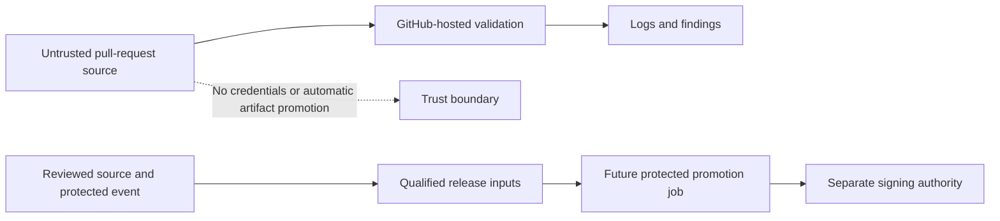
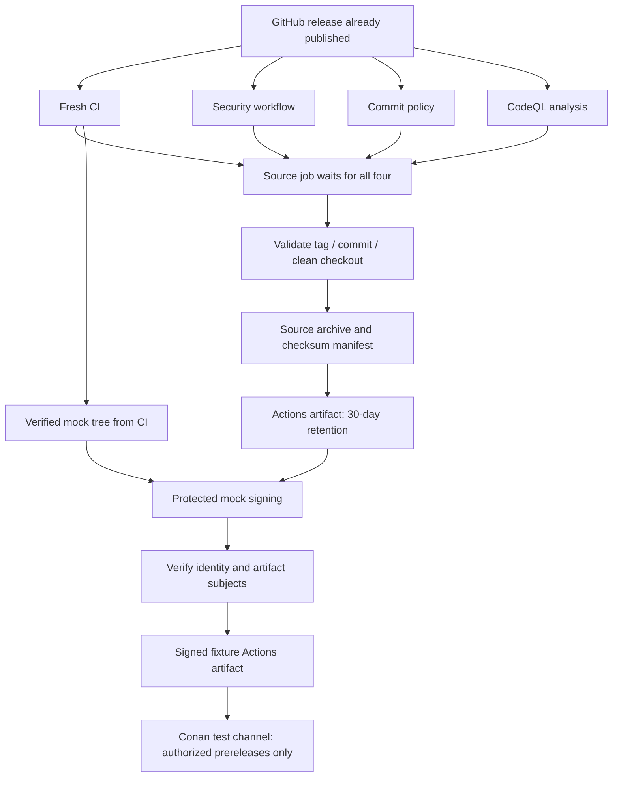

<!--
SPDX-FileCopyrightText: 2026 Rafael V. Volkmer <rafael.v.volkmer@gmail.com>
SPDX-License-Identifier: GPL-3.0-only
-->

# Automation architecture

The workflows in this checkout derive from
[Coil's workflows](https://github.com/frostlanguage/coil/tree/main/.github).
Local actions, configuration, and Lua checks are stored in this repository;
workflow execution does not depend on a moving Coil branch.

<strong>On this page</strong>

- [Execution layers](#execution-layers)
- [Guides](#guides)
- [Local checks](#local-checks)
- [Repository configuration](#repository-configuration)
- [Release boundary](#release-boundary)
- [CICD-003: Execution authority](#cicd-003)
- [CICD-009: Commit and license policy](#cicd-009)
- [CICD-010: Security and release](#cicd-010)
- [CICD-012: Changes to the pipeline](#cicd-012)
- [Scope and authority](#scope-and-authority)
- [CI control map](#ci-control-map)
- [Selective engineering campaigns](#selective-engineering-campaigns)

---

## Execution layers

| Layer | Responsibility | Implemented scope |
| --- | --- | --- |
| Lua | Apply policies, plan work, execute tools and validate results. | Existing CI and release scripts; local process pilot. |
| Ansible | Prepare hosts and coordinate Lua commands. | Localhost preparation and delegation to the four-control Lua campaign. |
| GitHub Actions | Supply events, runners, permissions and artifact transport. | Workflows listed in the [catalog](workflow-catalog.md). |

Keep acceptance logic and matrices in Lua. Contributors can invoke Lua without Ansible.
The [process pilot](../runbooks/process-pilot.md) has four registered verifiers and accepts only `local`.
The reusable lint workflow invokes its `process-ci` campaign and retains the requirement evidence graph.
Qualified host preparation, remote campaigns and protected promotion remain listed in the [gap
register](../assurance/gaps.md).

---

## Guides

- [Semantic and PGO qualification](../runbooks/qualification.md): Actions graph, compiler
  interoperability, independent rebuilds, flag profiles and evidence gates.
- [C analysis campaigns](../runbooks/c-analysis.md): independent engines, custom rules,
  architecture and artifact audits, bounded verification and qualification limits.
- [Cache layout](cache.md): repository-local disposable state.
- [Service bootstrap](../runbooks/security-services.md): GitHub Secrets,
  trust roots, OpenSSF adapters, and remaining prerequisites.
- [Distribution SDD](../specs/libmemalloc-distribution-SDD.md): the shared
  installation contract and planned publication channels.
- [CI reference](#ci-control-map): controls, jobs, trust boundaries, and SDD coverage.
- [Reproducible builds](../assurance/reproducible-builds.md): deterministic packaging,
  independent reconstruction, workflow models, and acceptance evidence.
- [Reproducible Builds tools](../runbooks/reproducibility.md): required upstream
  tool campaigns, independent packages and catalog applicability.
- [OpenSSF security](../assurance/openssf.md): the path to the Gold badge,
  supporting tools, and requirements that need maintainer action.
- [Product specifications](../specs/README.md): planned allocator contracts.
- [Release fixture](../runbooks/release-fixture.md): Lua release checks, Renovate, signatures,
  Conan publication, and current qualification gaps.

See the [workflow catalog](workflow-catalog.md) for entry points, execution environments and coverage.

Pushes and pull requests target all branches, including the refactor branch.
Merge queues, manual runs, tags, the default branch, and releases receive full
validation. Other changes select checks by path. REUSE always runs.
Scheduled security checks run weekly on the default branch.
Local documentation links are checked on every selected run. External links
are checked on the default branch, manual runs, and releases.

Third-party actions use commit SHAs. Downloaded tools use versions and digests
from `tools/toolchain/lock.toml`. Dependency installation disables lifecycle
scripts where supported. Validation permissions are read-only, and checkouts do not retain
credentials. Pull requests and merge queues use GitHub-hosted runners.
The protected signing job has OIDC authority; publication jobs use scoped credentials.

Ubuntu CI preparation uses the shared `bootstrap-ubuntu` action. It requires
Ubuntu 24.04 and its `ubuntu.sources` distribution file. Image-provided extra
APT feeds are preserved under `/etc/apt/libmemalloc-disabled-sources` and removed
from the active source search path. Compiler provisioning can subsequently add
the explicitly required PPA. Custom Linux runners must provide this Ubuntu
layout and be disposable; the action changes their APT configuration.

APT uses bounded acquisition retries and timeouts, and treats incomplete index
updates as failures. The bootstrap installs distribution prerequisites once per
job and records their installed versions. These packages follow Ubuntu's signed
repositories rather than exact package-version pins; subsequent Lua and compiler
identities remain governed by the toolchain lock. Failed preparation uploads a
separate `libmemalloc-bootstrap.*` diagnostic artifact, even before qualification
cases can run. That artifact does not replace missing case evidence or satisfy
the qualification gate.

Reconstruction installs its declared GCC 13 compiler directly from Ubuntu; it
requires neither the GCC 15 PPA nor the complete qualification compiler set.
Qualification and native build provisioning register required PPAs without an
implicit index update. A shared installer explicitly refreshes all indexes,
retries failed operations at most four times with delays of 5, 10 and 20 seconds,
and stops before package installation if the refresh remains incomplete.
Compiler setup failures retain separate diagnostics; unavailable repositories
remain failures after the retry budget is exhausted.

Repository scripts use Lua. A system Lua 5.4 interpreter bootstraps the lock
reader; subsequent checks use the pinned Lua runtime. Python-based third-party
tools such as REUSE and yamllint run in isolated environments. The C and Lua
metrics adapters in `tools/analysis/` use locked Python analysis APIs
under Lua controllers. The [Lua quality gate](lua-quality.md) documents shared
complexity limits, counting conventions and retained evidence. The Conan recipe remains a native packaging interface.

---

## Local checks

Follow the [local checks runbook](../runbooks/local-checks.md). Its commands require a prepared checkout
and the declared tools. Source checks inspect working files, including untracked additions; Git hooks and
release checks use their own index or commit boundaries. Hosted events and platform campaigns have separate entry points.

---

## Repository configuration

`LIBMEMALLOC_CI_RUNNER` optionally selects a runner for trusted events. Cache
services are optional; see the
[cache configuration](../../tools/ci/cache-plane/README.md).
Keep private runners limited to branches whose contributors can run trusted code.
The workflows work without external cache credentials.

Set `LIBMEMALLOC_REQUIRE_SIGNED_COMMITS=true` to require GitHub-verified OpenPGP
commit signatures. This supplements the existing signature guide; DCO is always
checked. Scope and body remain optional, as specified by the commit guide.
The Coil hooks are not installed or used because their message policy differs.

Apply the [main ruleset](../../.github/main-ruleset.json) to require pull requests,
`CI gate`, `Commit policy`, `Gitleaks`, `GitHub Actions security` and signed commits
on `main`, without bypass actors. Keep `develop` unprotected and allow direct
pushes; its CI results remain feedback rather than a push barrier. GitHub settings
are not changed by committing these files. See the
[branch integration policy](../../GOVERNANCE.md#codeowners-policy).
Renovate proposes updates against the refactor branch; its scheduled workflow
must reach the default branch to execute. Dependabot version updates are disabled
to avoid duplicates. Configure the protected environments and secrets listed in
the [release fixture guide](../runbooks/release-fixture.md).
Tool and npm dependency updates must keep the lock and package files in sync.

---

## Release boundary

Publishing a release triggers validation once through the `published` event.
Only successful validation produces an Actions artifact using a deterministic
source-packaging recipe and checksum manifest, retained for 30 days. Independent
reconstruction is not checked by this job. This workflow does
not create releases, upload release assets, or deploy a website or container.

This branch contains a Lua-driven C release fixture, not an allocator implementation.
The current C jobs validate policies, the fixture, and documentation examples.
The platform matrix and batched semantic qualification execute the mock across
languages, toolchains and flags. Allocator-specific properties and coverage
remain pending the implementation. The separate documentation workflow builds Doxygen and contains
a Pages deployment job; its event and branch conditions are documented in the
[documentation guide](../getting-started/documentation.md#hosted-validation-and-publication).

The module gate uses the compiler-backed mock subset described in the
[campaign guide](../runbooks/c-analysis.md). `LIBMEMALLOC_MODULE_CHECKER` can override it with
a qualified external checker. The current checks do not enforce every C-guide rule.

---

## CICD-003: Execution authority

**Class:** SECURITY. **Obligation:** project requirement.

Start workflows with `permissions: {}` and grant each job only the permissions
it uses. Current validation uses `contents: read`; checkout disables persistent
credentials. Third-party actions use full commit pins.

Pull requests and merge groups use GitHub-hosted runners. The optional
`LIBMEMALLOC_CI_RUNNER` setting applies to other events; a push to an untrusted
branch is not safe merely because it is a push. Restrict access before choosing
a private runner, and do not expose signing credentials or private networks to it.

Pass event fields through environment variables and quote them. Never interpolate
pull-request text into executable shell source. Do not check out and execute
untrusted code in a privileged `pull_request_target` or `workflow_run` context.

---

## CICD-009: Commit and license policy

**Class:** GOVERNANCE. **Obligation:** project requirement.

The commit validator enforces the local commit guide: Conventional Commits,
70-character lines, and DCO trailers. Scope and body remain optional. The
`LIBMEMALLOC_REQUIRE_SIGNED_COMMITS` setting adds GitHub-verified OpenPGP checking;
do not describe that option as enabled without inspecting the repository setting.

REUSE validates license metadata. Preserve imported attribution. Repository-wide
annotations do not by themselves demonstrate every per-source-file licensing
criterion of the [OpenSSF Gold plan](../assurance/openssf.md).

---

## CICD-010: Security and release

**Class:** SECURITY. **Obligation:** project requirement.

The security workflow runs zizmor and dependency auditing, scans history with
Gitleaks, and checks gittuf metadata when present. Its optional gittuf mode is
not an adopted mandatory signing policy. Scheduled security runs use the default
branch and must be investigated when they fail.

The `published` release event starts fresh CI, security, commit validation, and CodeQL.
The source job waits for all four. It validates the tag format, source identity,
and clean checkout, then packages source and a checksum manifest as an Actions
artifact retained for 30 days. It does not upload release assets or sign them.
Because the event follows publication, it cannot prevent the initial publication
of the GitHub release itself. A future promotion gate must run before distribution.

The [implemented fixture](../runbooks/release-fixture.md) adds two clean same-host mock
builds, dual SBOMs, subject-bound test logs, and local provenance statements.
The protected signing job creates and verifies Sigstore bundles after the gates.
An authorized prerelease can publish `libmemalloc-mock` to a configured Conan
test remote. These jobs do not qualify production allocator releases or SLSA L3.
Use the [OpenSSF adoption stages](../assurance/openssf.md#ossf-015) for the remaining
governance, scanner, isolated-builder, and distribution requirements.

---

## CICD-012: Changes to the pipeline

**Class:** CHANGE_CONTROL. **Obligation:** project requirement.

A pipeline change must update affected fixtures, locks, documentation, and indexes.
Run positive and negative policy tests, validate Actions syntax and security,
and exercise changed scripts locally. Explain checks that require hosted events,
external credentials, or a native target and could not be run locally.

Do not register services, change repository protection, publish artifacts, or
claim a badge as a side effect of editing these guides. Those actions require
maintainer authorization and evidence from the actual repository configuration.

---

## Scope and authority

**Class:** PROJECT_POLICY. **Obligation:** project requirement.

The executable configuration is under [.github/workflows](../../.github/workflows).
These reference pages explain its contract; changes to the configuration must update the
contract and tests together. Use the [workflow catalog](workflow-catalog.md) for the workflow inventory.
Controls marked as requirements for future product jobs do not imply those jobs exist.

The [semantic qualification graph](../runbooks/qualification.md) runs in GitHub Actions and
qualifies the implemented mock across optimization, PGO, compiler boundaries and
independent reconstruction. It is required by `CI gate`. Pending allocator
contracts remain explicit and cannot inherit the mock's successful result.

There is no allocator build or supported-platform release matrix in this tree yet.
The C gates exercise policy fixtures, the release mock, and complete C-guide examples. The proposed
SDD laboratory, Rust implementation, GC, performance campaigns, and product
coverage gates have not been implemented by those checks.

---

## CI control map

The CI contract lives with the reference for each concern. Preserve its `CICD-*` identifiers when editing
implementation, policy or evidence requirements. These controls describe the existing automation and its
declared limits; they do not qualify the planned allocator.

| Control | Canonical reference |
| --- | --- |
| CICD-001 | [Events and selection](workflow-catalog.md#cicd-001) |
| CICD-002 | [Required results](workflow-catalog.md#cicd-002) |
| CICD-003 | [Execution authority](automation.md#cicd-003) |
| CICD-004 | [Tools and dependencies](toolchain.md#cicd-004) |
| CICD-005 | [Source and documentation checks](documentation-checks.md#cicd-005) |
| CICD-006 | [Spelling, prose, and references](documentation-checks.md#cicd-006) |
| CICD-007 | [C evidence](c-verification.md#cicd-007) |
| CICD-008 | [Cache trust](cache.md#cicd-008) |
| CICD-009 | [Commit and license policy](automation.md#cicd-009) |
| CICD-010 | [Security and release](automation.md#cicd-010) |
| CICD-011 | [Failure and evidence handling](evidence.md#cicd-011) |
| CICD-012 | [Changes to the pipeline](automation.md#cicd-012) |

---

## Selective engineering campaigns

The `engineering` change category selects release-contract, qualification and
reproducibility campaigns for changes to source, build, packaging, automation,
tests, tools or workflows. Trusted integration and release events force all
categories. The CI gate requires success for selected campaigns and an explicit
skip for unselected ones. Documentation-only changes retain their documentation
and language checks without scheduling unrelated release qualification.

`tools/testing/suites.lua` lists executable automation suites and identifies
fixtures owned by domain campaigns. The automation runner rejects missing or
unregistered tests. Source checkers include new working files and omit deleted
files before staging; release snapshots keep their separate identity contract.

<!-- EOF -->

