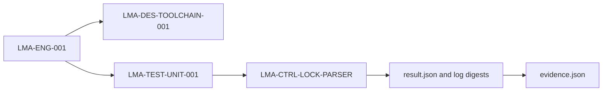

<!--
SPDX-FileCopyrightText: 2026 Rafael V. Volkmer <rafael.v.volkmer@gmail.com>
SPDX-License-Identifier: GPL-3.0-only
-->

# Evidence and assessment records

**Status:** the common evidence model below is proposed; the [local pilot](../runbooks/process-pilot.md)
implements the bounded automation subset. Its machine schemas live in
[tools/process/schemas](../../tools/process/schemas/).

<strong>On this page</strong>

- [Record states and ownership](#record-states-and-ownership)
- [CICD-011: Failure and evidence handling](#cicd-011)
- [Requirement evidence graph](#requirement-evidence-graph)
- [SDD coverage boundaries](#sdd-coverage-boundaries)

---

## Record states and ownership

Keep these states separate:

| Record | Example states | Meaning |
| --- | --- | --- |
| Execution | `PASS`, `FAIL`, `BLOCKED`, `INFRA_ERROR`, `NOT_RUN` | What happened to planned work. Preserve native statuses through a declared mapping. |
| Control assessment | `MET`, `PARTIAL`, `MISSING`, `NOT_APPLICABLE` | Local evidence judgment, as already defined by OSSF-001. |
| Acceptance decision | Approved, changes requested, pending | Authorized decision for an identified revision and scope. |

A complete plan with all applicable required results is an input to acceptance. It does not manufacture
review independence, maintainer availability, training, organizational scope approval or SPICE process capability.
Only permitted applicability decisions can exclude a required criterion. Store a missing owner or credential
as a prerequisite gap rather than passing it through an empty execution.

Each assessment row should include the following fields; the catalog format is proposed:

| Field | Content |
| --- | --- |
| Identity | Local control ID, external framework/edition/criterion, obligation and mapping rationale. |
| Scope | Product or mock, component, target/configuration and applicability decision. |
| Policy and procedure | Exact versioned section and the responsible role. |
| Implementation | Existing script, configuration or human practice that performs the control. |
| Expected evidence | Required observation and acceptance conditions before execution. |
| Observed evidence | Immutable run/artifact reference, content digest and actual result. |
| Review | Reviewer identity, decision time, assessed revision and unresolved findings. |
| Lifecycle | Classification, retention owner, expiry/reassessment condition and permitted deviation. |

For example, link the badge's `test_policy_mandated` criterion to the adopted testing policy and to evidence
of its application. Map verification evidence to outcomes in the explicitly selected SPICE reference and
assessment models. Use their actual identifiers and selected editions, not a similar identifier from another
model. The [workflow assurance guide](../assurance/workflow.md) describes process assessment and security
evidence separately.
For OSPS-BR-01.03, examine actual untrusted-code isolation and credential boundaries, not only a YAML permission
line. Select TISAX ISA item identifiers only after the organization chooses its applicable assessment catalog.

For each execution, retain the commit and dirty-state identity, specification/configuration digests, plan
digest, run/attempt IDs, tool versions, host/target identity, command arguments, start/end, exit status and
expected versus returned cases. Include hashes of logs and artifacts, the required-output inventory, and
references to human decisions. A hash supports content identity; provenance also needs a trusted producer
and protected storage or an appropriate attestation.

Write local working records under `.cache/logs/` or the existing campaign paths. The
[cache policy](../reference/cache.md) treats these as disposable. Promote selected results into a controlled
artifact store or the immutable release evidence tree, with retention, access control and retrieval checks.
Cache existence is not evidence retention. A mutable "latest" URL is insufficient for a historical decision.

Use an approved restricted store for private reports, access records, personnel data and incident details.
The public mapping may reference a sanitized summary or an opaque evidence identifier with an access owner.
Record the retention period required by the project's obligations rather than inventing a universal duration.

---

## CICD-011: Failure and evidence handling

**Class:** ANALYZABILITY. **Obligation:** project requirement.

Keep failures visible. Record the command, exit status, selected scope, and tool
identity. A timeout, missing tool, skipped platform, and failed assertion have
different meanings. Product campaigns must preserve raw logs and machine-readable
results under the SDD evidence contract. Current Actions logs are not a complete
implementation of that proposed evidence store.

For release evidence, use immutable artifact names tied to source identity and
verify their contents on download. Preserve failure diagnostics without publishing
secrets or attacker-controlled executable content. Retention must cover the
release's support period; the current 30-day Actions artifact is temporary storage.

---

## Requirement evidence graph

The [control catalog](../../tools/process/controls.json) now declares requirements, design references and
verification IDs. Catalog and plan schema version 2 requires these links; version 1 plans must be regenerated.
Existing `LMA-ENG-001` through `LMA-ENG-004` remain stable identifiers for engineering requirements.
Product requirements retain their SDD identifiers and need actual executable verifiers before enrollment.

Each requirement declares a nonempty `design` list and a nonempty `verification` list. A verification maps
to one registered executable control and declares its kind. The bounded catalog currently supports unit,
analysis and integration checks. Formal, stress and benchmark enrollment needs executable acceptance
contracts; an invented link must not imply completed coverage.

The engine rejects duplicate IDs, dangling references, orphan nodes, untraced controls and verification
links assigned to another requirement. One requirement may need several verifications; every observation
must pass for that requirement to pass. Failed verifications preserve their native status, including timeout
and infrastructure failures, while the requirement receives `FAIL`.

Every completed run writes `evidence/evidence.json`, following
[the evidence schema](../../tools/process/schemas/evidence.schema.json). It binds the graph to the run, plan,
policy and source digests. Each requirement contains its statement, design IDs and evidence entries with
verification ID, kind, control, status, artifact path and SHA-256. Paths are relative to the evidence directory.
The referenced `result.json` binds the command, observation and stdout/stderr hashes.

The gate checks the complete inventory, result hashes, log hashes, commands and completion markers before
reconstructing the graph and comparing it with the retained document. Missing or altered links and artifacts
block the gate. An interrupted run may lack a graph; the campaign still attempts gate and report finalization
and returns failure. The graph preserves execution outcomes, while `gate.json` records the integrity verdict.
The existing producer trust and human acceptance boundaries still apply.

The `process-ci` task runs these four engineering controls through the same Lua campaign locally and in CI.
It does not replace the broader build, qualification, release or reproducibility campaigns. The hosted adapter
retains the graph with the process logs. Its digest comes from the candidate catalog for regression evidence;
this is not a protected policy approval or a release authorization.

---

## SDD coverage boundaries

| Product contract | Current evidence | Work still required |
| --- | --- | --- |
| [Documentation gates](../specs/libmemalloc-tests-SDD.md#lma-test-012) | Markdown, spelling, links, C-guide examples | SDD snippet extraction and semantic product checks |
| [Release reconstruction](../specs/libmemalloc-compilation-SDD.md#lma-build-014) | Source packaging and two-build mock comparisons | Independently operated reconstruction and frozen product binary inputs |
| [Strict core dependencies](../specs/libmemalloc-compilation-SDD.md#lma-build-015) | Design contract only | Implemented core, link maps, undefined-symbol audit |
| [Build trust](../specs/libmemalloc-security-SDD.md#lma-sec-010) | Pins, verified downloads, workflow audits | Product profile provenance and release promotion |
| [Campaign evidence](../specs/libmemalloc-tests-SDD.md#lma-test-037) | Mock campaign plans, result records and CI artifacts | Product campaigns with replayable manifests and raw results |
| [Qualification matrix](../specs/libmemalloc-tests-SDD.md#lma-test-038) | C-guide profiles and mock language/ABI matrix | Qualification of each advertised product target and capability |
| [GC evidence](../specs/libmemalloc-tests-SDD.md#lma-test-039) | Specification only | GC implementation and graph-oracle campaigns |

<!-- EOF -->

