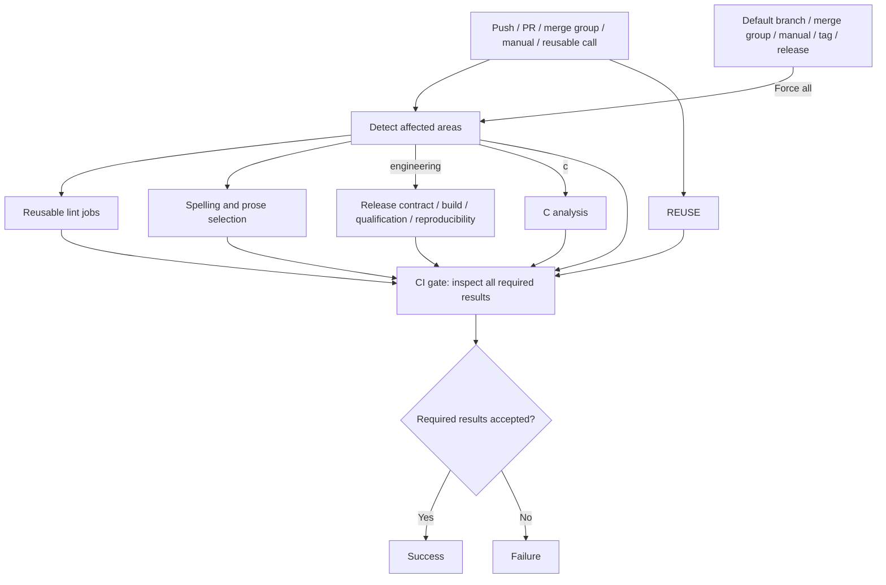

<!--
SPDX-FileCopyrightText: 2026 Rafael V. Volkmer <rafael.v.volkmer@gmail.com>
SPDX-License-Identifier: GPL-3.0-only
-->

# Workflow catalog

This catalog describes the workflow files in the current checkout. It does not assert that remote jobs have
run successfully. GitHub Actions supplies the hosted events, permissions, runners and artifact transport.
The Ansible process adapter delegates four engineering controls to Lua; the reusable lint workflow retains
the resulting requirement evidence graph.

<strong>On this page</strong>

- [Checks and campaigns](#checks-and-campaigns)
- [Hosted services and publication](#hosted-services-and-publication)
- [Process pilot](#process-pilot)
- [CICD-001: Events and selection](#cicd-001)
- [CICD-002: Required results](#cicd-002)

---

## Checks and campaigns

Paths in the command column are repository entry points. Follow the linked runbook for arguments, required
tools and evidence handling. Local adapters reproduce their stated work, not the entire hosted workflow.

The reusable lint entry point delegates to six responsibility groups:
[automation](../../.github/workflows/_lint-automation.yml),
[documents and web](../../.github/workflows/_lint-documents.yml),
[native builds](../../.github/workflows/_lint-native.yml), [Lua](../../.github/workflows/_lint-lua.yml),
[Python](../../.github/workflows/_lint-python.yml) and [shells](../../.github/workflows/_lint-shell.yml).
Each group retains explicit input filters, permissions and job timeouts. Cache service validation is a
separate [Lua policy](../../scripts/github/lib/cache_plane.lua); the composite action handles runner inputs.

Before changing the documentation publication branch, update its push filter, Pages packaging guard and
deployment guard together. Run `lua scripts/check/workflows.lua`; the same consistency check runs before
documentation publication and in local checks. The validator also preserves the allowed events and the
deployment dependency on successful validation. It rejects unknown guard layouts for explicit review.

Conan publication installs the `publication` group from [uv.lock](../../tools/python/uv.lock), using the
existing locked Python installer with source builds disabled. The graph pins transitive versions and
artifact hashes; a stale lock or unavailable compatible wheel fails installation. Update the central Conan
version, regenerate the Python manifest and update the lock before publishing. No credentials are needed
to prepare or verify this environment; authorization remains at the protected publication job.
See [uv's locked synchronization contract](https://docs.astral.sh/uv/concepts/projects/sync/).

| Workflow | Hosted entry point | Local commands or guide | Environment and coverage |
| --- | --- | --- | --- |
| [`documentation.yml`](../../.github/workflows/documentation.yml) | PR, merge queue, push to `feature/libmemalloc-refactor` and manual execution. | `lua scripts/documentation/main.lua build`; [documentation guide](../getting-started/documentation.md). | Read-only validation and full Doxygen build; Pages deployment after validation on the configured publication branch. |
| [ci.yml](../../.github/workflows/ci.yml) | Push, PR, merge group, manual, reusable call | [Local checks](../runbooks/local-checks.md) | Selects reusable checks and campaigns; `CI gate` reconciles required jobs. |
| [_lint.yml](../../.github/workflows/_lint.yml) | Reusable call | `scripts/check/c.lua`, `scripts/check/lua.lua`, `scripts/check/doc_examples.lua`, `scripts/check/mermaid.lua`, `scripts/check/sdd.lua`; [documentation checks](../getting-started/documentation.md) | Declared lint tools; languages, configuration, examples and diagrams. Native Ansible bootstrap, tools, cleanup, builds and documentation on macOS ARM and Intel. |
| [_spelling.yml](../../.github/workflows/_spelling.yml) | Reusable call | `scripts/check/links.lua`; spelling tools from the workflow | CSpell, codespell, typos, Vale and links. |
| [_reuse.yml](../../.github/workflows/_reuse.yml) | Reusable call | `reuse lint` with repository configuration | SPDX and license metadata. |
| [specifications.yml](../../.github/workflows/specifications.yml) | Issue label events and manual execution. | [Specification procedure](../procedures/specifications.md). | Trusted default-branch metadata reconciliation; maintainer roster and current write permission. |
| [commit-policy.yml](../../.github/workflows/commit-policy.yml) | Push, PR, manual, reusable call | `lua scripts/check/commits.lua REVISION` | Git history and commit policy; hosted signature checks have additional context. |
| [build-matrix.yml](../../.github/workflows/build-matrix.yml) | Manual, reusable call | `scripts/build/plan.lua`, `scripts/build/run.lua`, `scripts/build/report.lua`; [build guide](../runbooks/build.md) | Profile-specific Linux, macOS and Windows workers; mock compatibility matrix. |
| [build-nightly.yml](../../.github/workflows/build-nightly.yml) | Schedule, manual | [Build](../runbooks/build.md) and [qualification](../runbooks/qualification.md) guides | Coordinates extended and clean campaigns. |
| [qualification.yml](../../.github/workflows/qualification.yml) | Manual, reusable call | `scripts/qualification/plan.lua`, `scripts/qualification/batch.lua`, `scripts/qualification/report.lua`; [qualification guide](../runbooks/qualification.md) | Producer/consumer artifacts, mock semantics, instrumentation and PGO. |
| [_qualification-batch.yml](../../.github/workflows/_qualification-batch.yml) | Reusable call | `scripts/qualification/dependencies.lua`, `scripts/qualification/batch.lua` | Prepared worker with its producer artifacts; preserves per-case records. |
| [_c-analysis.yml](../../.github/workflows/_c-analysis.yml) | Reusable call | `scripts/analysis/run.lua`, `scripts/check/c_analysis.lua`, `scripts/check/msvc.lua`; [C analysis](../runbooks/c-analysis.md) | Campaign tools and native MSVC host where required. |
| [c-analysis-nightly.yml](../../.github/workflows/c-analysis-nightly.yml) | Schedule, manual | [C analysis](../runbooks/c-analysis.md) | Invokes the reusable extended analysis workflow. |
| [reproducible.yml](../../.github/workflows/reproducible.yml) | Schedule, manual, reusable call | `scripts/reproducible/`; [reproducibility](../runbooks/reproducibility.md) | Independent packages, comparisons, environment variations and normalizers. |
| [openssf.yml](../../.github/workflows/openssf.yml) | Schedule, manual | `scripts/security/plan.lua`, `scripts/security/run.lua`, `scripts/security/report.lua` | Adapter-specific tools and service prerequisites; explicit blockers. |
| [_release-checks.yml](../../.github/workflows/_release-checks.yml) | Reusable call | `scripts/release/build.lua --mock`, `verify.lua`, `check_schemas.lua`; [fixture guide](../runbooks/release-fixture.md) | Mock builds, evidence validation, negative tests and Conan packages. |

---

## Hosted services and publication

| Workflow | Hosted entry point | Purpose and boundary |
| --- | --- | --- |
| [security.yml](../../.github/workflows/security.yml) | Push, PR, schedule, manual, reusable call | Workflow/dependency audit, secret scanning and optional gittuf policy. Individual tools can run locally with their prerequisites. |
| [codeql.yml](../../.github/workflows/codeql.yml) | Push, schedule, manual, reusable call | CodeQL database capture, queries and hosted result upload; no process-pilot adapter. |
| [scorecard.yml](../../.github/workflows/scorecard.yml) | Schedule, manual | Repository assessment and SARIF upload; public Scorecard API publication remains disabled in the workflow. |
| [renovate.yml](../../.github/workflows/renovate.yml) | Schedule, manual | Dependency pull requests with scoped credentials. Runs as a hosted service. |
| [release.yml](../../.github/workflows/release.yml) | Published release | Validation, source packaging, protected signing and authorized mock-channel publication. No manual-dispatch entry point. |

Reusable-only workflows need a caller. Workflows with manual dispatch can run through the Actions interface
when available on the appropriate repository branch and with the required permissions. Local commands do not
replace protected environments, OIDC identity or publication authorization.

---

## Process pilot

The [process pilot runbook](../runbooks/process-pilot.md) documents `scripts/process/main.lua` with `plan`, `run`,
`gate`, `report` and `campaign` subcommands, plus `infra/ansible/playbooks/prepare.yml` and `verify-environment.yml`.
The `local` profile executes four controls. `_lint.yml` invokes the same `process-ci` task through Ansible;
phase ordering and evidence validation live in Lua. Track additional adapters and protected promotion in the
[gap register](../assurance/gaps.md).

---

## CICD-001: Events and selection

**Class:** CORRECTNESS. **Obligation:** project requirement.

Run CI on pushes, pull requests, merge groups, manual dispatches, and reusable
workflow calls. The change detector selects affected checks on ordinary branch
changes. Default-branch pushes, merge groups, manual runs, tags, and releases
force the full selection. REUSE runs independently of the selection. PRs use the bounded build and
qualification campaigns described in their runbooks. Manual runs, merge groups and default-branch pushes
select integration builds and the broad qualification campaign; tags/releases select release qualification.

Treat detection failure as a failure, not an empty diff. Test rename, deletion,
shared configuration, and language detection behavior before changing the detector.
Keep Python detection and its lint job: repository-owned scripts are Lua, but
Python source introduced elsewhere still requires validation. HTML, CSS, JavaScript and TypeScript have
separate change categories; the web job runs only selected languages with indexed sources. See
[the web checker](../../scripts/check/web.lua) and [tool graph](../../tools/lint/code/web/package-lock.json).

**Evidence:** [entry workflow](../../.github/workflows/ci.yml) and
[detector tests](../../tests/automation/workspace/changes_test.lua).

---

## CICD-002: Required results

**Class:** CORRECTNESS. **Obligation:** project requirement.

The stable `CI gate` runs with `always()` and evaluates the executable
[acceptance contract](../../scripts/check/lib/ci_gate.lua). Detection, lint and REUSE must succeed.
Engineering campaigns must succeed when `engineering` is true and must be skipped otherwise. Selected
spelling and C analysis must succeed; their unselected reusable workflows may report success or skipped.
Every cancellation, failure, unknown result or missing detector output fails the gate.

<!-- BEGIN GENERATED CI GATE -->
| Job | Selection | Selected result | Unselected result |
| --- | --- | --- | --- |
| `changes` | Always | `success` | N/A |
| `lint` | Always | `success` | N/A |
| `reuse` | Always | `success` | N/A |
| `spelling` | `SPELLING_CHANGED` | `success` | `success` or `skipped` |
| `c-analysis` | `C_CHANGED` | `success` | `success` or `skipped` |
| `release-checks` | `ENGINEERING_CHANGED` | `success` | `skipped` |
| `build-matrix` | `ENGINEERING_CHANGED` | `success` | `skipped` |
| `qualification` | `ENGINEERING_CHANGED` | `success` | `skipped` |
| `reproducibility` | `ENGINEERING_CHANGED` | `success` | `skipped` |
<!-- END GENERATED CI GATE -->

[Regression tests](../../tests/automation/check/ci_gate_test.lua) exercise all detector combinations and
verify the workflow's dependencies, result bindings and this generated table against that same contract.

Branch protection must require this result, commit policy, and the security
results relevant to the branch. Repository files do not configure those settings.
A maintainer must verify the required check names and a failing pull request in
GitHub before describing merge protection as enforced.

Do not use `continue-on-error` to hide a required finding. Optional diagnostics
must have separate names and must not satisfy a required gate.

<!-- EOF -->

