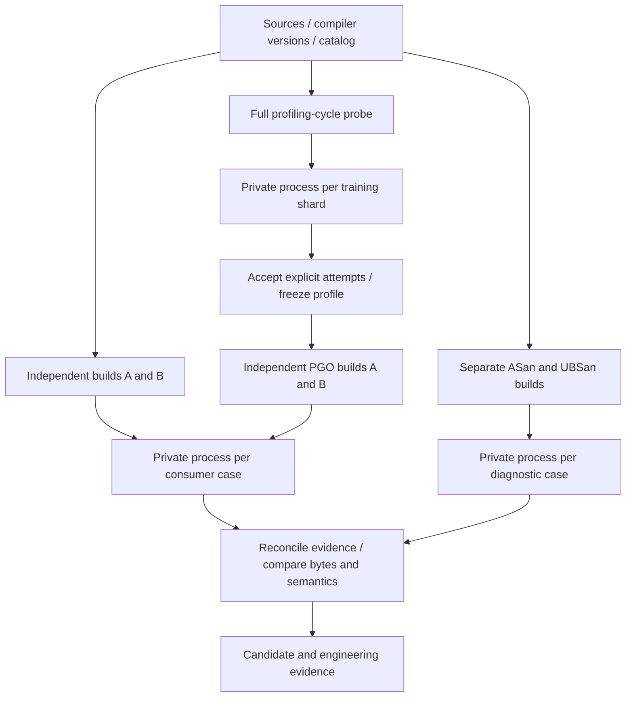

<!--
SPDX-FileCopyrightText: 2026 Rafael V. Volkmer <rafael.v.volkmer@gmail.com>
SPDX-License-Identifier: GPL-3.0-only
-->

# Semantic and PGO qualification

GitHub Actions executes this graph directly. Each execution batch runs
on a hosted Ubuntu VM; its cases consume binaries from producer jobs. Kubernetes
and Argo are not required. Tests never compile the library. The existing
compatibility matrix also covers Windows, macOS, WebAssembly and emulated Linux
targets under its declared profiles.

The implemented API is `MOCK_identity()`. Its independent oracle requires 257
calls to return zero and one canonical trace. This qualifies the distribution
fixture and pipeline. It does not qualify an allocator or prove absence of
undefined behavior. Reports contain `product_qualified: false` and pending product
obligations. Replacing the mock requires a new contract and corpus.

<details>
<summary><strong>On this page</strong></summary>

- [Executed graph](#executed-graph)
- [Flags and domains](#flags-and-domains)
- [Configuration and readable executors](#configuration-and-readable-executors)
- [PGO and binary boundaries](#pgo-and-binary-boundaries)
- [Evidence and reconstruction](#evidence-and-reconstruction)
- [Local validation](#local-validation)

</details>

---

## Executed graph



[`qualification.yml`](../../.github/workflows/qualification.yml) is called by
CI on pushes, pull requests, merge groups and release validation, and by the
nightly workflow. It supports manual dispatch. `CI gate` requires its result.
Jobs use read-only repository permissions and actions pinned to commits.

The [catalog](../../tools/build/qualification.lua) generates dynamic matrices.
Every campaign covers C99, C11, C17 and C23 with GCC 15.2 and Clang 18,
using `-O0` and `-O2` on PRs. Nightly and release campaigns additionally cover
`-O1`, `-O3`, `-Ofast`, `-Os`, `-Oz` and `-O3` with LTO. **C23 is the PGO training and reconstruction
default.** The signed Ubuntu
toolchain repository supplies GCC 15; execution rejects a version different
from the lock. Nightly runs and releases also run all declared flag profiles.

Each producer links consumers from both toolchains in C99 through C23 and
C++98, C++03, C++11, C++14, C++17, C++20, C++23 and the C++26 development mode.
C++26 does not imply complete conformance to the future standard. Consumer
standards appear in task names. The C implementation remains C; the public
header and actual binary boundary are tested by separately compiled consumers.

The compatibility workflow requests the same C++ range for **every** compiler
profile and every supported C edition. Compiler probes verify both the selected
option and `__cplusplus`. Unsupported optional dialects are recorded individually
in `unsupported_tests`; they do not count as executed tests. Missing required
modes, build failures and runtime failures still fail the gate. MSVC cannot
provide selectable C++98, C++03 or C++11 modes. No fallback silently substitutes
a newer dialect.

The Zig musl target and Emscripten WebAssembly target run on pushes and pull
requests, including optimization and flag profiles. WebAssembly executes under
the Node runtime bundled with the SDK. Neither target is linked to the native glibc artifacts:
those ABI domains are separate. Older GCC compatibility profiles remain in the
platform matrix; they do not supply C23 PGO profiles.

The PR plan contains **668 tasks**, retaining both compilers, every C dialect, all cross-language
consumers, diagnostics, independent reconstruction and PGO. The nightly/release plan contains
**3,556 tasks**. The separate execution plan
assigns them to **42 worker jobs**, plus planning and reconciliation: **44 jobs**
for this qualification workflow. This count excludes the platform matrix, lint
and other CI workflows. The broad campaigns retain every declared language, flag and consumer combination.
A passing PR qualifies only its explicit selection; omitted modes are not reported as executed.

| Stage                                          | Worker jobs |
| ---------------------------------------------- | ----------: |
| Ordinary builds, with separate A/B replicas    |           8 |
| Instrumentation                                |           2 |
| Training                                       |           2 |
| Profile reduction                              |           2 |
| PGO reconstruction, with separate A/B replicas |           4 |
| Consumer execution                             |          12 |
| Diagnostic compilation                         |           4 |
| Diagnostic execution                           |           8 |

The [execution policy](../../tools/build/qualification-execution.lua) controls
partitions, relative cost estimates and timeouts. The deterministic planner uses
weighted partitions per compiler and replica. Consumers of the same producer stay
together. Every job downloads its required producer packages once and uploads
one package containing all individual manifests, logs and a batch manifest.
The preserved plan records every assignment and dependency before execution.

Cases run sequentially within a batch, bounding its compiler and process load.
Each case has a fresh process session, private home and temporary directories,
an explicit environment and a timeout. Surviving processes in that session are
terminated and fail the batch. Artifact hashes are rechecked after each case.
The process boundary limits functional interference. Cases share the host and need an external security
boundary for untrusted workloads. A/B reconstruction jobs retain distinct runners and
never share compiled outputs. Performance promotion remains a separate obligation.

A case failure does not stop independent cases. Missing inputs become retained
infrastructure failures. Both the per-case inventory and the execution-batch
inventory must be complete at the final gate; a successful batch exit cannot
substitute for individual results. The workflow summary identifies every case
and provides its exact reproduction command through retained command logs.

---

## Flags and domains

The native ELF campaign includes signed and unsigned `char`, strict and disabled
alias analysis, `-fwrapv`, freestanding compilation without builtins, disabled
inlining and vectorization, function and data sections, stack protection, frame
pointers, the x86 red-zone option, `NDEBUG`, and debug information. A compile,
link and execution probe precedes each ordinary flag profile. Required support
failures produce `UNSUPPORTED` and fail the gate. GCC 15 and Clang 18 are the
selected versions for `-Oz`; other versions need a new probe.

The [MSVC catalog](../../tools/build/msvc-flags.lua) adds `/Od`, `/O1`, `/O2`,
`/Ox`, size and speed preferences, inlining and intrinsics, strict and fast
floating point, unsigned `char`, security options, `/GL` with `/LTCG`, and
`NDEBUG` to the Windows compatibility runner. CMake checks flags before
executing the API and target-model tests.

`-Ofast` and `/fp:fast` have a separate relaxed floating-point classification.
The mock has no floating-point operations. A passing mock does not admit those
options into a future strict allocator profile. Character signedness and signed
wrap extensions also retain explicit semantic profiles. Changes to packing,
enum size, calling conventions, target ISA or runtime require a distinct ABI
contract; they are not arbitrary additions to a cross-toolchain pair.

The catalog is a reviewed selection from the
[GCC option summary](https://gcc.gnu.org/onlinedocs/gcc/Option-Summary.html),
[Clang command-line reference](https://clang.llvm.org/docs/ClangCommandLineReference.html),
and [MSVC compiler
options](https://learn.microsoft.com/en-us/cpp/build/reference/compiler-options-listed-alphabetically?view=msvc-170).
Those references also contain driver, language-specific, target-specific and
mutually exclusive options. They are not an executable Cartesian matrix.

---

## Configuration and readable executors

Campaign choices belong to [the qualification catalog](../../tools/build/qualification.lua).
The [host policy](../../tools/build/qualification-host.lua) selects tools,
packages, flags, timeouts and binary requirements. The
[fixture contract](../../tools/build/qualification-fixture.lua) selects source
files, artifacts, expected traces and diagnostic controls. Compiler IDs identify
matrix producers; their explicit backend selects the profiling adapter.

The planner derives artifact inventories from the configured consumers and
shards. Changing a shard name or adding a consumer must update the required
evidence automatically. Policy tests exercise those changes. The native adapter
still implements Linux ELF mechanics; another platform requires its own
qualified adapter and policy.

Build and analysis installation choices live in
[build provisioning](../../tools/build/provision.lua) and
[analysis provisioning](../../tools/analysis/c/provision.lua). The installers
resolve locked versions and execute commands; tests record their command plans
for every configured host without installing packages.

Keep declarations, side effects, checks and output as visible groups according
to the [Lua layout guide](../standards/lua/lua-comments.md) and the
[C standard](../standards/c/c-code-standard.md). In YAML, separate triggers, permissions,
jobs and steps with blank lines. Comments explain dependencies, trust boundaries
and exceptions. Preserve literal shell blocks while editing their surrounding
YAML. Formatting is not a claim of full naming, SESE or semantic compliance.

---

## PGO and binary boundaries

Both adapters first prove the whole profiling cycle. GCC uses `.gcda` and
`gcov-tool-15`; Clang uses `.profraw` and `llvm-profdata-18`. Each training shard
has its own task and attempt directory. The merge accepts the shard manifests
declared by the catalog. The default campaign uses two shards with 1,000 and
3,000 operations and unit counter weights. GCC reduces additional shards in
order, applying each original weight once. Probe profiles remain outside the
accepted training set.

Baseline and PGO candidate both use `-O3`, producer-local LTO and the same
hardening. Profiling uses atomic counters. Missing or mismatched profiles are
errors. GCC dump evidence and LLVM entry-count metadata must demonstrate profile
application. Reconstruction consumes the verified merged profile without
retraining.

Each producer builds consumers with both compiler families. C calls directly;
C++ calls through a function pointer. Consumer optimization differs from the
producer. Ordinary C consumers link native static archives; C++ consumers link
shared libraries. LTO and PGO consumers use a native shared-library boundary,
so GCC GIMPLE and LLVM bitcode are never exchanged.

Final libraries are inspected once per build for ELF identity, exact exports,
forbidden imports, profiling or LTO remnants, hardening and the size budget.
Every native non-PGO C dialect, optimization and flag profile has a separate
ASan/UBSan build of the core and C/C++ consumers. The consumers execute under
those instruments and must match the same oracle. Deliberately faulty controls
use fixed settings so optimization cannot erase the defect being used to test
the detector. These controls are not evidence about the optimized product.

PGO candidates receive final-artifact semantic and binary checks. Their sanitizer
twins do not reuse PGO profiles: sanitizer instrumentation changes the build.
Platform compatibility jobs, including Zig and WebAssembly, provide
language, target and runtime-trace evidence; they do not claim per-profile
ASan/UBSan coverage. None of these finite tests proves absence of all UB.

Silent instrumentation failures cannot satisfy the diagnostic controls. Existing static-analysis
and bounded-formal campaigns remain separate CI dependencies.

The cross-platform matrix checks the same canonical mock trace under each OS,
architecture and dialect, including MSVC flags. Its CTest cases still share a
profile job. Native ELF and sanitizer cases use the private process/session contract
within their assigned jobs.

---

## Evidence and reconstruction

Every task records campaign, task, source-input digest, plan digest and attempt,
plus command logs and file hashes. Dependencies are verified before execution
and bound to producer manifest hashes. The finalizer runs after failed stages,
reconciles the expected inventory, rejects missing or extra evidence, checks
dependency identities, and compares canonical traces.

`PASS`, `FAIL`, `UNSUPPORTED`, `NOT_APPLICABLE`, `INCONCLUSIVE` and `INFRA_ERROR`
are distinct. Only `PASS` satisfies a required task. Failed assertions are not
retried automatically. Rerun the entire workflow after an infrastructure failure:
partial reruns cannot combine old and new attempt manifests.
Every batch and the final gate display this policy before provisioning or artifact downloads. The planning
job exports its attempt identity; a different or missing identity stops the consumer with an explicit
**Re-run all jobs** instruction. A complete rerun generates a new plan and new evidence for that attempt.

Independent A/B jobs bypass object caches, use different paths and compare exact
library and consumer bytes, including library debug information. Both use the
same source timestamp and normalized paths. Different compiler families are
compared semantically, never by requiring equal binary hashes.

Compiler versions are checked against the lock; tools are hashed and runner,
kernel and CPU identities are recorded. Hosted images and package mirrors remain
mutable. These checks detect drift and provide bounded reconstruction evidence;
they do not establish a hermetic build service. Artifacts have 30-day retention
and do not replace a long-term release evidence store.

No performance promotion runs on shared hosted hardware. Reserved-hardware
budgets, concurrent allocator histories, failure injection, an allocator model,
previous-release ABI comparison, and MSVC/freestanding PGO are pending. Those
missing contracts prevent product qualification. The existing mock release
packaging is a separate artifact and does not inherit PGO qualification.

---

## Local validation

```sh
lua tests/automation/qualification/policy_test.lua
lua tests/automation/qualification/integration_test.lua --campaign=pr
```

The integration suite requires the same compiler and profiling tools. It executes
the assigned batches, compares artifacts and tests rejection of missing and
corrupt evidence. Local reconstruction shares one host; Actions separates A/B
jobs onto independent VMs.
All three campaigns exercise the same declared dialect and flag profiles.

<!-- EOF -->

