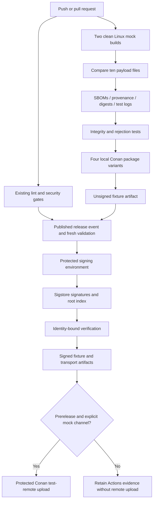

<!--
SPDX-FileCopyrightText: 2026 Rafael V. Volkmer <rafael.v.volkmer@gmail.com>
SPDX-License-Identifier: GPL-3.0-only
-->

# Release fixture, dependency maintenance, and Conan

The repository implements a native Linux release fixture using `core/main.c`
and a zero-result library function. It exercises release engineering without
claiming an allocator implementation, product coverage, a Gold badge, or a
qualified SLSA level. Production promotion fails closed.

<details>
<summary><strong>On this page</strong></summary>

- [Patterns adopted from the reference repositories](#patterns-adopted-from-the-reference-repositories)
- [Implemented flow](#implemented-flow)
- [Local execution](#local-execution)
- [Signatures and trust](#signatures-and-trust)
- [Conan publication](#conan-publication)
- [Renovate operation](#renovate-operation)
- [Qualification boundaries](#qualification-boundaries)
- [Full local validation](#full-local-validation)

</details>

---

## Patterns adopted from the reference repositories

| Reference | Adopted pattern | Application here |
| --- | --- | --- |
| [hl-infrastructure Renovate workflow](https://github.com/guesant/hl-infrastructure/blob/main/.github/workflows/renovate.yml) | Separate scheduled dependency-maintenance job with scoped credentials | Protected `renovate` environment, explicit repository scope, release-age delay, and review before merge |
| [hl-infrastructure Scorecard workflow](https://github.com/guesant/hl-infrastructure/blob/main/.github/workflows/scorecard.yml) | Separate repository-practice assessment | Scheduled Scorecard JSON retained as an artifact; external result publication remains disabled |
| [shared-tooling-configs discovery model](https://github.com/guesant/shared-tooling-configs) | Distinguish configured tools from documentation mentions | The OpenSSF roadmap and this implementation inventory record separate states |
| [shared-tooling-configs structure](https://github.com/guesant/shared-tooling-configs#structure) | Separate policy, tool configuration, and reusable recipes | Release policy under `tools/release/`, shared Lua helpers, thin CI entry points, and a native Conan recipe |

The reference repositories provide patterns, not an executable dependency.
No remote workflow from either repository executes inside the release jobs.
The project keeps its own lock authority, licensing policy, and Lua drivers.

---

## Implemented flow



`_release-checks.yml` participates in the required CI gate. It exercises static
and shared libraries in Release and Debug configurations, validates the evidence,
and exports four Conan packages into a runner-local cache. The release workflow
waits for CI, security, commit policy, and source packaging before signing.

`scorecard.yml` runs without release signing or repository-write permissions.
Its results describe repository practices; they do not replace payload tests.

---

## Local execution

Run from the repository root with Lua, GCC, GNU binutils, Git, jq, and GNU
core utilities installed. The current native targets are Linux `x86_64` and
`aarch64`; only the host architecture is built. The hosted matrix currently
executes `x86_64`. Windows DLL generation remains pending.

```bash
lua tests/automation/release/release_test.lua
lua scripts/release/build.lua --mock --version=0.0.0-mock
lua scripts/check/reproducible.lua --root=release/<target>-<build-id>
lua scripts/check/openssf.lua --root=release/<target>-<build-id>
lua scripts/release/verify.lua --root=release/<target>-<build-id> --unsigned
lua tests/automation/release/release_test.lua --root=release/<target>-<build-id>
lua scripts/release/check_schemas.lua --root=release/<target>-<build-id>
lua scripts/release/package.lua --root=release/<target>-<build-id>
```

Replace placeholders with the path printed by the build driver. Each platform
root contains `bins/release/`, `bins/debug/`, `materials/`, `identity/`, `sbom/`,
`attestations/`, `test_logs/`, `digests/`, and `integrity/`. The executable suffixes
`-static` and `-shared` distinguish the two smoke-test consumers. The `.a`, `.so`,
and `.map` names follow the [release directory contract](../assurance/openssf.md#ossf-010).

Schema validation also requires the locked `check-jsonschema` client. It downloads
and verifies the official schemas; `--cache=<directory>` uses existing
`cyclonedx.schema.json` and `spdx.schema.json` files with the same pinned digests.

The driver refuses to overwrite an existing root. Use a fresh `--output` parent
to repeat the same inputs. Build identifiers exclude temporary paths and attempt
identifiers. Test records retain the attempt identity outside the build key.

---

## Signatures and trust

`scripts/release/sign.lua` verifies a candidate and creates a separate signed
copy. Cosign signs payloads, SBOMs, and provenance files; a final signature seals
the complete file inventory. The original candidate remains unchanged.
`scripts/release/verify.lua` checks the root signature, exact file set, full
digests, individual payload signatures, and evidence subjects.

Hosted signing uses the protected `release-signing` environment and GitHub OIDC.
The consumer must supply the expected workflow identity and issuer. Maintainers
must configure environment reviewers and tag protection; committing the workflow
does not configure those hosting controls.

Local tests may use an external disposable Cosign key with `sign.lua --offline`.
Verification then requires `--key`, `--trusted-root`, and `--offline`. This
explicit mock mode skips transparency-log verification and must not serve as
the release trust policy. Keep private keys outside the repository and artifacts.
The normal hosted and Conan publication paths do not enable this exception.

Transport archives remain outside the sealed tree and have their own checksum
and index reference. Their contained root index authenticates the extracted
tree. The hosted packaging step also signs the archive and its checksum record;
local callers opt in with `package.lua --sign`. Platform-generated SLSA
attestations remain qualification work; signing local provenance JSON does not
establish L2 or L3 provenance integrity.

---

## Conan publication

The user-authorized `packaging/conan/conanfile.py` is the sole native recipe.
Repository build, checks, signature verification, and publication orchestration
remain Lua. The Python lint area continues to validate the recipe.

Use a dedicated Conan cache and run `conan profile detect` before invoking
`lua scripts/release/conan.lua --root=<verified-root>`. The driver exports static
and shared Release/Debug packages without uploading, then links and runs a consumer
against each exported package. Conan-generated environment
scripts stay in temporary directories. Export receipts live outside the sealed
tree under `.cache/cd/publications/`.

The package name is `libmemalloc-mock`, preventing confusion with a production
allocator package. The recipe installs stable library names and preserves the
ELF loader name for shared-library consumers. It packages existing verified
bytes; it does not rebuild the C sources.

For the post-release test-channel job, configure:

| Setting | Purpose |
| --- | --- |
| Protected environment `conan-release` | Review and restrict publication authority |
| Repository variable `LIBMEMALLOC_CONAN_MOCK_CHANNEL=true` | Explicit consent to publish the fixture package |
| Variable `CONAN_REMOTE_URL` | HTTPS upload endpoint controlled by the project |
| Secrets `CONAN_USERNAME` and `CONAN_PASSWORD` | Credentials scoped to that test repository |
| Prerelease event | Prevent the fixture channel from masquerading as a stable allocator release |

ConanCenter publication is a separate contribution and review process. This
workflow uploads to the configured Conan remote; it does not submit to ConanCenter.
Remote publication remains untested until maintainers provide the endpoint,
credentials, environment rules, and an authorized hosted execution.

---

## Renovate operation

`.github/renovate.json5` configures GitHub Actions, npm, and annotated tool-lock
entries. Renovate targets `feature/libmemalloc-refactor`, delays new releases
for seven days, limits open pull requests, and disables automatic merging.
Dependabot version pull requests are disabled to avoid duplicate updates;
repository security alerts remain a separate host setting.

The scheduled workflow executes trusted configuration from the default branch.
Maintainers must install the configuration there before scheduling can work.
Set `RENOVATE_TOKEN` in the protected `renovate` environment with access limited
to this repository. The token needs the permissions required for dependency
branches, pull requests, and the dashboard. Repository lifecycle scripts and
post-upgrade commands remain disabled.

Renovate proposes annotated tool versions. It does not invent asset checksums:
review the version and SHA-256 together and run the verified-download checks.
Documentation package updates must also satisfy the existing Lua tool-lock
consistency check. An update that changes only one authority fails CI.

---

## Qualification boundaries

The mock checks repeatable outputs on one host, with fresh directories and
timezone variation. It does not isolate networks or freeze the host filesystem,
kernel, loader, and complete system-library closure. Compiler components and
declared source inputs have recorded hashes; this is not a hermetic build claim.

The Lua SBOM emitter covers declared fixture artifacts and recorded tools. Its
checks validate subject consistency, and `scripts/release/check_schemas.lua`
validates both formats against checksum-pinned upstream schemas. Independent
component discovery needs further integration.
Bomctl, Protobom, SBOMit, OpenVEX triage, CVE Binary Tool, Fuzz Introspector,
Package Analysis, GUAC, and Repository Service for TUF remain adoption work.
The fixture records `NOT_RUN` for vulnerability analysis and makes no exploitability
claims. Governance tools and assessments still need accountable maintainers.

The C fixture uses the compiler-backed module-architecture subset documented in
the [C campaign guide](c-analysis.md). Existing Portuguese
SDD prose still fails the English spell and prose policy. Those failures block
the hosted release graph; they must not be bypassed to publish the mock.

---

## Full local validation

New release metadata uses sorted JSON object keys, two-space indentation, LF
line endings, and a final newline. The builder formats `identity/build-inputs.json`
before computing the build identifier. Digests and signatures cover the formatted
bytes. The signing driver also formats new Sigstore envelopes before indexing
them; their signed payloads remain unchanged.

The verifier still accepts immutable legacy `identity/build-inputs.jcs.json`
manifests. It rejects a tree containing both manifest names. Do not reformat an
existing sealed release; generate a new candidate to adopt the readable layout.

Run `lua scripts/workspace/cache.lua lua scripts/check/all.lua --offline --output=.cache/logs/checks/<run-id>`
in an isolated, indexed snapshot containing the current working files. Pass
`--root=<candidate-root>` to include the generated evidence and signature tests.
Offline runs with a candidate also require `--schema-cache=<directory>`.
The driver runs
applicable validators and continues after failures, recording commands, status,
log paths, and log digests in `results.json`. Missing tools count as failures.
The offline mode checks local links and leaves the network advisory audit for
a separate online execution.

The runner includes Markdown, Mermaid, spelling, prose, Lua, C, Actions security,
YAML, JSON, TOML, license, secret, Renovate, and native-recipe Python checks.
Its result describes local execution, not a completed GitHub run. Review the
full report before deciding whether a release candidate can advance.

<!-- EOF -->

