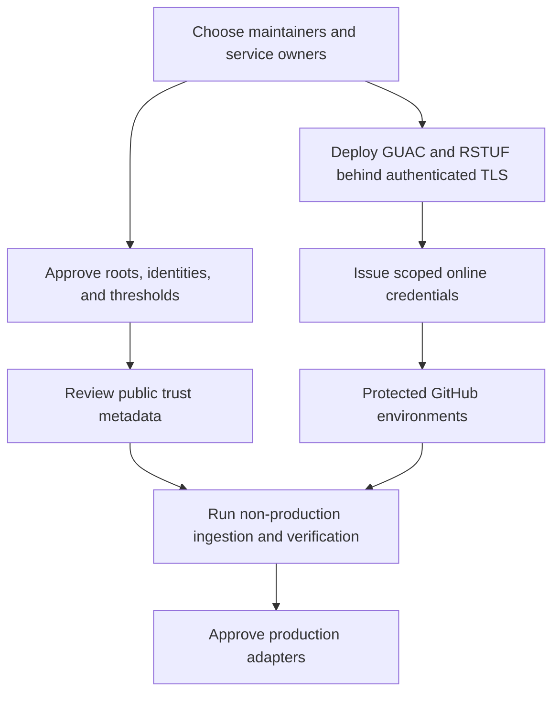

<!--
SPDX-FileCopyrightText: 2026 Rafael V. Volkmer <rafael.v.volkmer@gmail.com>
SPDX-License-Identifier: GPL-3.0-only
-->

# Security service bootstrap and GitHub credentials

<details>
<summary><strong>On this page</strong></summary>

- [Current state](#current-state)
- [Variables and secrets](#variables-and-secrets)
- [Provisioning order](#provisioning-order)
- [gittuf recovery](#gittuf-recovery)
- [Actions coverage](#actions-coverage)
- [References](#references)

</details>

---

## Current state

The workflows do not yet implement the complete OpenSSF adoption plan. Fourteen catalog entries have
executable adapters, some with deliberately narrow scope; six remain blocked by missing policy, product inputs
or deployed services. The [coverage workflow](../../.github/workflows/openssf.yml) now generates its matrix
from the catalog and always reconciles available results. Missing reports, failed tools and blocked adapters
prevent complete coverage.

The public [libmemalloc assessment](https://www.bestpractices.dev/en/projects/12710/baseline-1) uses project
ID `12710`. Reads need no API token. The adapter retrieves current status and checks that the public license
matches the repository policy. Best Practices Gold, OSPS Baseline and SLSA levels are distinct claims; running
an adapter does not award any of them.

---

## Variables and secrets

Ordinary CI, reproducibility tools, dependency scans and public badge reads need **no user-created secrets**.
GitHub supplies `GITHUB_TOKEN` automatically with the permissions declared by each job. Do not create a secret
with that name. The Gitleaks CLI used here does not require a Gitleaks Action license secret.

These are the custom secrets that the workflows consume:

| Secret            | GitHub location             | Used by         | When needed                                                                                       |
| ----------------- | --------------------------- | --------------- | ------------------------------------------------------------------------------------------------- |
| `RENOVATE_TOKEN`  | Environment `renovate`      | `renovate.yml`  | Required for the self-hosted dependency-update job                                                |
| `CONAN_USERNAME`  | Environment `conan-release` | `release.yml`   | Only for the explicitly enabled prerelease mock channel                                           |
| `CONAN_PASSWORD`  | Environment `conan-release` | `release.yml`   | Password or publishing token issued by the selected Conan remote                                  |
| `SCORECARD_TOKEN` | Repository secret           | `scorecard.yml` | Optional read-only PAT for classic branch-protection visibility; otherwise GitHub's token is used |

For Renovate, select only this repository and follow its
[fine-grained token permissions](https://docs.renovatebot.com/modules/platform/github/#running-using-a-fine-grained-token):
write access to contents, pull requests, issues, commit statuses and workflows, plus read access to Dependabot
alerts. Organization membership reads apply to organization-owned repositories. Workflow write access allows
updates to pinned Actions. The token must belong to an identity allowed to create branches and PRs. An
installation token from a GitHub App is short-lived and needs a token-minting step; the current workflow
expects an already valid token.

The optional
[Scorecard PAT](https://github.com/ossf/scorecard-action/blob/main/docs/authentication/fine-grained-auth-token.md)
needs read-only Administration and automatically included Metadata permissions for the selected repository.
GitHub repository rulesets are readable using the default token. Do not grant this token write access.

| Variable or policy                        | GitHub location                      | Effect                                                                                                              |
| ----------------------------------------- | ------------------------------------ | ------------------------------------------------------------------------------------------------------------------- |
| `BEST_PRACTICES_PROJECT_ID`               | Repository variable                  | Optional numeric override; defaults to the public identity catalog's `12710` and still validates the repository URL |
| `CONAN_REMOTE_URL`                        | Environment `conan-release` variable | Authorized HTTPS package endpoint                                                                                   |
| `LIBMEMALLOC_CONAN_MOCK_CHANNEL=true`     | Repository variable                  | Enables Conan publication only for prereleases; absent or false disables it                                         |
| `LIBMEMALLOC_CODEQL_ENABLED=true`         | Repository variable                  | Opts a private repository into CodeQL; the GitHub account must also have the required entitlement                   |
| `LIBMEMALLOC_REQUIRE_SIGNED_COMMITS=true` | Repository variable                  | Enables the additional signature verification gate; it does not provide a signing key                               |
| `LIBMEMALLOC_CI_RUNNER`                   | Repository variable                  | Optional trusted runner label for selected jobs; untrusted PR paths retain hosted runners                           |
| `release-signing`                         | Protected GitHub environment         | Restricts who can run the existing keyless release signing job                                                      |

Sigstore uses GitHub OIDC through the signing job's `id-token: write` permission. There is no
`COSIGN_PRIVATE_KEY`, `COSIGN_PASSWORD`, cloud key or other signing secret to add for this path. Verification
pins the workflow/ref and OIDC issuer. Conan credentials belong to the package server, not GitHub or Sigstore.

Create the `renovate`, `conan-release` and `release-signing` environments in **Settings → Environments**, with
the desired branch/tag restrictions and reviewers. Add environment secrets there. Add `SCORECARD_TOKEN` only
if needed under **Settings → Secrets and variables → Actions**. Variables use the corresponding Variables tab.
Fork PR jobs do not receive these credentials.

Equivalent interactive CLI setup, after creating the environments:

```sh
gh secret set RENOVATE_TOKEN --env renovate
gh secret set CONAN_USERNAME --env conan-release
gh secret set CONAN_PASSWORD --env conan-release
# Optional when using classic branch protection:
gh secret set SCORECARD_TOKEN
# Public assessment identity, not a secret:
gh variable set BEST_PRACTICES_PROJECT_ID --body 12710
```

Enter values at the CLI prompt; do not put credentials in shell history, source files or chat. These are setup
instructions, not changes already made to GitHub.

The following proposed service settings are **not consumed by an active adapter**:

| Proposed setting                          | Missing prerequisite                                                         |
| ----------------------------------------- | ---------------------------------------------------------------------------- |
| `GUAC_ENDPOINT`, `GUAC_TOKEN`             | A deployed, authenticated GUAC service and a qualified ingestion adapter     |
| `RSTUF_API_URL`, `RSTUF_TOKEN`            | A deployed RSTUF service, reviewed root custody and online publishing policy |
| gittuf public root and reference policy   | Maintainer-approved signed trust metadata in the repository                  |
| OpenVEX statements                        | Reviewed product-specific vulnerability dispositions                         |
| Package Analysis sandbox                  | Disposable package-execution infrastructure isolated from credentials        |
| SBOMit collectors and verification policy | Qualified build-time collection and in-toto verification inputs              |

Do not add placeholder service secrets expecting these integrations to start. GitHub Secrets does not
provision a service or establish a trust root. Offline root private keys do not belong in the Actions secret
store.

---

## Provisioning order



For GUAC, start with the upstream local deployment to qualify SBOM ingestion and queries. Choose persistent
storage, authentication, backups, and retention before hosting production evidence. The documented in-memory
demo is not durable storage. Verify signed evidence before ingestion; a graph entry is not a signature.

For gittuf, select maintainers and supported signing identities, initialize the root, then initialize the
policy and reference rules. Have the required owners sign and review the metadata. Keep recovery instructions
and test key rotation. CI should verify authorized source updates; it should not hold enough root keys to
replace the maintainer trust policy on its own.

For RSTUF, provision its API, worker, storage, and supported online signing backend. Establish offline
root-key custody and a signature threshold through a maintainer ceremony. Distribute a trusted root to clients
and test expiration, rotation, rollback rejection, and target digest verification. Keep offline root private
keys outside GitHub Secrets; use a supported KMS/HSM for online keys when available. The API credential and
TUF signing keys serve different purposes.

---

<a id="gittuf-recovery"></a>

## gittuf recovery

The security workflow checks out an exact commit, which leaves Git in detached HEAD state. Before
verification, it creates the selected local branch at that checked-out commit: the trusted base SHA for
pull requests or the event SHA for branch pushes and manual runs. Annotated tag objects remain unchanged.
A missing local branch causes `requested Git reference not found`; creating the branch does not authorize
its commit. A matching signed RSL entry is still required.

The security workflow fetches historical targets named by the RSL for the selected reference and gittuf
metadata before running `gittuf verify-ref`. An RSL message contains an object ID; it does not keep that
object reachable in Git. A full-history checkout can therefore omit a replaced annotated tag object.
Recovery fetches exact object IDs from `origin`. It does not change tags, policy, RSL entries or signatures.

The `main` branch uses history verification from the signed reconstruction entry
`fdb4556ded199f692bf9d20c6830fbb56cf954e4`, which records commit
`15b857a99ba45ba79ae3b8b6c52b94cffa9145d1`. Its earlier first entry,
`35d4d1efa173accce67587827acba60be46c56fb`, used an unauthorized key and was revoked in
`13dd8074b838c3452f5ba429c9e7a3ca302e5777`.
gittuf 0.15.0 cannot recover that invalid first entry because no preceding valid state exists.
The fixed reconstruction entry is the verification boundary; every later branch entry and the policy
history must still validate. Missing entries, unauthorized signatures and a mismatched current tip fail.
The `--from-entry` option requires `GITTUF_DEV=1` in this pinned version. Other branches retain complete
history verification. Tags use `gittuf verify-ref --latest-only` to check the
current tag against its latest RSL entry and applicable policy. Policy history is still validated. Older
states of the same tag are not revalidated against its current object: gittuf 0.15.0 rejects that comparison
after a tag replacement, even when the earlier entry has a withdrawal annotation. Replacing a published tag
requires explicit maintainer authorization and a new signed RSL entry; CI cannot authorize the replacement.

If recovery fails, a maintainer must restore the original object from a trusted clone or backup and retain
it under an archival reference. Do not recreate an equivalent tag: its object ID and signature would differ.
If verification then reports a reference mismatch, inspect the RSL and the published tag with an authorized
signing identity. Do not move a published tag to make the check pass. Follow the
[signature guide](../standards/versioning/signature-guide.md) and publish a new version when needed.

For a reviewed, newly created release tag, gittuf 0.15.0 supports the following local preparation, using the
signing key authorized by the repository policy:

```sh
release_ref='refs/tags/<new-version>'
gittuf rsl record --local-only "${release_ref}"
gittuf verify-ref --latest-only "${release_ref}"
git push --atomic origin "${release_ref}" refs/gittuf/reference-state-log
```

Synchronize the existing gittuf metadata before preparing the entry. The atomic push publishes the tag and
its signed record together, so tag-triggered verification sees both. Never force-push the RSL. CI has read
permission only and cannot create maintainer signatures. Optional mode skips an absent policy; an initialized
policy still has to verify successfully. Re-running an old tag uses the workflow stored in that tag, so a
workflow fix must be included in the next reviewed release candidate.

### Record a reviewed main merge

A GitHub merge creates a new commit without running the local gittuf signing step.
The GitHub commit signature does not replace the authorized SSH signature required by the branch policy.
After reviewing the exact merged commit, synchronize the RSL, record that commit and publish only the
new RSL entries. Use an isolated clone so that updating its local `main` does not disturb pending work:

```sh
git fetch origin main 'refs/gittuf/*:refs/gittuf/*'
git update-ref refs/heads/main refs/remotes/origin/main
ssh-add ~/.config/libmemalloc/gittuf/maintainer
env GIT_CONFIG_COUNT=2 \
  GIT_CONFIG_KEY_0=gpg.format GIT_CONFIG_VALUE_0=ssh \
  GIT_CONFIG_KEY_1=user.signingkey \
  GIT_CONFIG_VALUE_1="$HOME/.config/libmemalloc/gittuf/maintainer.pub" \
  gittuf rsl record --local-only refs/heads/main
GITTUF_DEV=1 gittuf verify-ref \
  --from-entry fdb4556ded199f692bf9d20c6830fbb56cf954e4 refs/heads/main
git -c core.hooksPath=/dev/null push origin refs/gittuf/reference-state-log
```

The one-command hook exception is limited to the verified metadata ref: the source hook expects OpenPGP
Conventional Commits, while gittuf requires its own record format and the authorized SSH key. Never apply
this exception to a source branch. The RSL push must be fast-forward; a concurrent update requires fetching
and reconciling the records before retrying. Re-run Security after publication if the merge check started
before its record was available. CI remains read-only and must fail until the reviewed record exists.

Pull requests into `main` verify the recorded base commit before integration. This check does not authorize
the future merge commit. After merging the hotfix, record the new `main` state before issuing the next
signed alpha tag and its RSL entry. Publish the new tag and RSL together with an atomic push.

---

## Actions coverage

`openssf.yml` schedules and manually dispatches a catalog-generated matrix of twenty projects.
`openssf-coverage` contains its complete JSON/Markdown report. The Lua driver records `PASS`, `FAIL`, or
`BLOCKED` with an explicit scope. A blocked adapter fails its job and uploads its reason; it does not produce
a successful security assessment. The matrix has no fail-fast cancellation. An always-running finalizer
rejects missing reports and preserves each blocker, even when an earlier job failed.

Executable adapters cover public badge/baseline reads, Criticality Score, Bomctl/Protobom conversion, CVE
Binary Tool, Fuzz Introspector source analysis, OSV-backed dependency scanning, draft Gemara and Security
Insights schema validation, Scorecard, mock provenance checks, and Sigstore regression tests. OSV scanning
consumes OSV data; it is not standalone validation of arbitrary advisory documents against the OSV Schema.
Static introspection does not supply fuzz-campaign coverage.

gittuf, GUAC, Package Analysis, OpenVEX, RSTUF, and SBOMit still have explicit qualification or provisioning
blockers in the project catalog. Running this workflow does not complete those integrations. Resolve each
blocker with an approved adapter and tests before treating that project as active. Package Analysis needs an
isolated execution environment for suspect packages; it must not share signing credentials, trusted caches, or
a privileged runner.

Scorecard also uploads SARIF to GitHub code scanning. Public Scorecard API/badge publication remains disabled:
enabling it requires the upstream restricted workflow layout and OIDC policy. SARIF upload is not public API
publication.

---

## References

- [GitHub Secrets](https://docs.github.com/en/actions/how-tos/write-workflows/choose-what-workflows-do/use-secrets)
- [GUAC ingestion and deployment](https://docs.guac.sh/guac/setup-ingest-data/)
- [gittuf root of trust](https://gittuf.dev/documentation/maintainers/root)
- [gittuf policy initialization](https://gittuf.dev/documentation/maintainers/policy/initialization)
- [Repository Service for TUF documentation](https://repository-service-tuf.readthedocs.io/en/stable/)
- [Sigstore blob signing](https://docs.sigstore.dev/cosign/signing/signing_with_blobs/)

<!-- EOF -->

