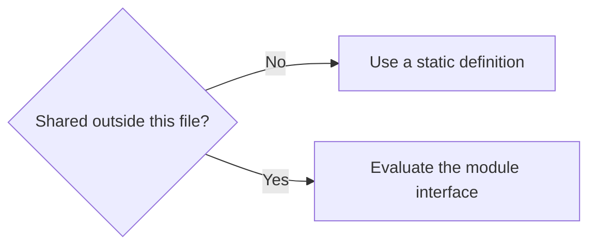

<!-- SPDX-FileCopyrightText: 2026 Rafael V. Volkmer <rafael.v.volkmer@gmail.com> -->
<!-- SPDX-License-Identifier: GPL-3.0-only -->

# Doxygen configuration and validation

Run from the repository root on Linux with Doxygen **1.18.0**, Lua, the pinned Node runtime and Graphviz `dot`
on `PATH`. Install the [locked documentation and web dependencies](../docs/getting-started/documentation.md#dependencies).
The Lua driver uses the repository's POSIX filesystem helpers. Initialize the pinned
[Doxygen Awesome](https://github.com/jothepro/doxygen-awesome-css) submodule once:

```sh
git submodule update --init -- doxygen/vendor/doxygen-awesome-css
lua scripts/documentation/main.lua build
lua scripts/documentation/main.lua eval
lua scripts/check/c.lua --doxygen-only
```

`build` writes the themed site to `.cache/docs/doxygen-build/html/index.html`, plus XML and a tag file.
`eval` parses the same selected inputs and generates XML under `.cache/docs/doxygen-eval/`, without HTML
or Graphviz. Any Doxygen warning or failed invocation fails the command. The normal C linter also runs
this evaluation; its documentation-only option needs neither Clang nor the other C scanners.
Evaluation does not need the theme checkout. Neither mode installs or downloads tools.

Set `LIBMEMALLOC_DOXYGEN` to an installed Doxygen executable and `LIBMEMALLOC_LUA` to the Lua executable
used by the source filter. The driver rejects a Doxygen version different from the lock.
The version and official Linux archive digest are recorded in
[the toolchain lock](../tools/toolchain/lock.toml). The version was checked against the
[official download page](https://www.doxygen.nl/download.html) on 2026-09-22.

The [Doxyfile](config/Doxyfile) contains all 315 options emitted by this version's `doxygen -g`, including explicit
values for inactive features. Empty values mean the documented default/automatic choice or an unused path;
they are not unfinished placeholders. Validation compares the full option inventory with the executable.
Do not copy options from a different version without regenerating and reviewing the catalog.

| Profile area | Selected behavior |
| --- | --- |
| Inputs | `core/`, the project `README.md`, `doxygen/pages/index.dox`, all Markdown under `docs/`, and linked local Markdown pages. |
| Native input formats | Retain the version's complete `FILE_PATTERNS` catalog. C output presentation is selected for this project. |
| Documentation | File, group, macro, enum, struct, union, typedef, callback, object, function, parameter, return, relation and member documentation. |
| Warnings | Missing/incomplete/invalid documentation remains enabled and fails the run. |
| Extraction | Documented static/private entities are included; `EXTRACT_ALL` remains disabled so missing documentation is detectable. |
| Preprocessing | Enabled; preserve macro definitions, avoid indiscriminate expansion, use explicit include paths. |
| Graphs | Include, included-by, call, caller, group and directory graphs; SVG through Graphviz. |
| Default output | CLI: `.cache/docs/doxygen-build/` or `.cache/docs/doxygen-eval/`. Direct Doxyfile invocation: `.cache/docs/doxygen/`. |
| Other output backends | Explicit configuration for LaTeX, RTF, man, DocBook, SQLite3, AutoGen and Perl; enable with the formats profile below. |
| External integrations | Tag files, bibliography, MathJax, PlantUML, Mermaid, MSC and other version-supported options remain available with their generated settings. Supply the actual external tools/paths when used. |

The native pattern catalog does not add parsers for unsupported languages. In particular, documenting Lua or
Rust needs a separately qualified filter/tool; mapping their extensions to C would not validate their semantics.
Similarly, language-specific optimization modes are alternatives, not switches to enable simultaneously.
See the [Doxygen configuration reference](https://www.doxygen.nl/manual/config.html).

## Source organization

```text
doxygen/
├── config/             Doxyfile and optional output-format profile
├── pages/              project and license Doxygen pages
├── web/
│   ├── scripts/        authored TypeScript browser enhancements
│   ├── styles/         project and syntax-highlighting styles
│   ├── fonts/          font files and their original license texts
│   └── templates/      maintained HTML fragments
├── licenses/           notices for reused styles and templates
├── design/             product and visual-design records
└── vendor/             pinned Doxygen Awesome submodule
```

The trusted Lua configuration and input filters live in `scripts/documentation/`. Each HTML build compiles
`web/scripts/*.ts` through the pinned TypeScript compiler into its own output directory's `web/` folder.
Doxygen copies those generated `.js` files into the published HTML directory. Authored TypeScript uses strict
DOM types; generated browser JavaScript stays outside versioned source. The upstream theme retains its own
JavaScript inside the pinned submodule.

`lua scripts/check/web.lua` runs HTML Validate, Biome and TypeScript checks against indexed authored inputs.
CI selects HTML, CSS, JavaScript and TypeScript areas from added, changed or removed paths. The compiler
configuration covers this site's TypeScript; add a reviewed project configuration when introducing a separate
TypeScript application. Tool installation uses `npm ci --ignore-scripts` and the integrity-locked web graph.

The Biome profile keeps two CSS exceptions within this site's styles: `!important` overrides generated
Doxygen/Mermaid styles, and selector order includes media-query and theme overrides. Other source trees retain
those recommended rules. The CSS parser and remaining lint rules still apply to these styles.

## Selecting implementation, pages and images

[config.lua](../scripts/documentation/config.lua) is the canonical, trusted project configuration.
`implementations` lists source directories, initially `core/`. All C/C++ sources and headers below those roots are
inventoried, including untracked files. `pages` lists Markdown/Doxygen files or directories; `mainpage` selects the
Markdown landing page. Pages are a separate input category: adding `docs/` as pages does not parse its C template
files.

The project `README.md` is the home page. Markdown files under `docs/` appear in the **Documentation**
navigation tree, grouped by their actual directory, except for `README.md` files (case-insensitive).
These directory indexes are excluded from publication, including discovery through links. Links to them
point to their source in the GitHub repository. The driver generates the layout from the inventory on
each run, so adding a document needs no handwritten navigation entry.

Existing local Markdown targets linked from selected pages are included recursively; this also publishes
supporting pages such as governance, security and tool instructions. Missing targets and broken anchors remain
Doxygen errors. The Project references branch uses the explicit `references` list in
`scripts/documentation/config.lua`: GOVERNANCE, MAINTAINERS, REVIEWING, ROADMAP, SECURITY,
SUPPORT, CHANGELOG, CODE_OF_CONDUCT, LICENSE and CONTRIBUTING. Other linked pages remain
available through their links without being added to that branch. The license page includes
the original `LICENSE` verbatim. The reference pages retain their penguin illustrations.
Use `--page=doc` to add another directory when it exists, or select individual files:

```sh
lua scripts/documentation/main.lua build --source=./core \
  --page=assets/images/README.md
lua scripts/documentation/main.lua eval --source=./core --output=.cache/docs/review
```

Repeated `--source` options replace configured implementation roots. Repeated `--page` and `--images` options
extend the configured lists. `--mainpage` replaces the landing page; `--config` selects another trusted Lua
configuration. Explicit paths must exist. Paths are repository-relative, may start with `./`, and must use
letters, digits, underscores, dots, slashes, plus signs or hyphens. Output must remain below `.cache/`, outside
implementation roots. Run `lua scripts/documentation/main.lua --help` for all options.

`images` searches `assets/images/`, `doc/` and `docs/` recursively by default; absent default roots are skipped.
The driver supplies image directories to `IMAGE_PATH`, and copies image assets into the HTML tree with their
repository-relative paths preserved. Use Markdown image links or Doxygen `@image`; the landing page demonstrates
the project SVG logo. Literal HTML can use a repository-relative path such as
`` on a top-level generated page.
Use unique image filenames for Doxygen's flat image lookup and relative paths appropriate to the rendered page.
Select narrower image roots in the configuration if some assets should not be published.
The project [stylesheet](web/styles/libmemalloc.css) follows the upstream theme sheets and explicitly preserves a
transparent background for the header logo and README logo. The original SVG is copied byte for byte;
it is neither rasterized nor given a white background.

During each `build`, [doxygen_brand.lua](../scripts/documentation/lib/brand.lua) derives a separate
mascot-only SVG from that source, removing the trailing wordmark layers and applying the square
`logo_viewbox` configured in `scripts/documentation/config.lua`. The copy is retained as
`libmemalloc-mascot.svg` in the output directory and in `html/`, where it serves both the header
logo and favicon. The helper rejects an unexpected logo structure instead of silently clipping
new artwork. The header subtitle is **The Magic of Memory Transmutation**.

[markdown-filter.lua](../scripts/documentation/filter.lua) prepares Markdown for Doxygen:
it scopes anchors by source path,
updates local and cross-page anchor links, and preserves fenced examples (including quoted examples) as literal
code with language metadata for highlighting; `mermaid` fences become native Doxygen diagrams.
This avoids global anchor collisions
and interpretation of Lua/Rust examples as Doxygen commands.
Cross-page fragments use Doxygen references so both inline and reference-style links resolve
to generated HTML rather than leaving `.md#...` URLs in the site. Root-relative `/assets/`
image paths become local paths, including when the site is opened directly from disk.
Authored Markdown retains its GitHub links and presentation. The filter rejects unclosed fences; markup
warnings remain fatal. Both build and evaluation use it.

## Code highlighting in Markdown

Label fenced blocks with their language, for example `c`, `cpp`, `rust`, `lua`, `sh`, `bash`, `cmake`,
`yaml`, `json`, `python`, `javascript`, `toml`, `ini`, `diff`, `xml`, `html`, `css` or `markdown`.
Common aliases (`h`, `hpp`, `c++`, `rs`, `yml`, `py`, `js`, `md`, `shell`) and Doxygen's `{.c}` notation
are accepted. The Rust `compile_fail` label receives Rust highlighting; it does not execute a compiler.

````markdown
```c
/* <Explain this value.> */
const unsigned int capacity = 16U;
```
````

The filter retains literal content in HTML and XML, including Doxygen commands, angle brackets and
illustrative identifiers. In HTML, [Highlight.js](https://highlightjs.readthedocs.io/en/latest/readme.html)
colors only recognized, explicitly labeled blocks. Text blocks, unlabeled blocks and unsupported languages
remain plain text; there is no automatic language detection. Mermaid rendering is independent.
Examples wrap visually without inserting newlines into copied code. Box-drawing diagrams retain
their columns and scroll only if needed; inline code can wrap on narrow screens.

The build generates a header from the installed Doxygen template and adds `code-highlight.js` as a classic
deferred script, allowing both direct `file://` viewing and HTTP(S). Local ES module scripts are blocked by
browser origin restrictions when the HTML is opened as a file.
Highlight.js and the grammars needed by the current page load from jsDelivr, with the version pinned in
`toolchain.lock.toml`. JavaScript and network access are required for colorization; examples remain readable
if either is unavailable. Colors follow the Doxygen theme in light and dark mode. No example is executed.

## Project reading layer

The driver loads [reading.css](web/styles/reading.css) after the upstream theme and
[libmemalloc.css](web/styles/libmemalloc.css). This layer owns reading width, heading rhythm,
control states, code contrast and small-screen spacing. The upstream submodule is unchanged.

[reading.ts](web/scripts/reading.ts) adds a keyboard skip link, a compact light/dark toggle,
an expandable section index and accessible copy icons for both Markdown and native
Doxygen code blocks. Existing authored "On this page" indexes are reused. Redundant
filename titles are hidden when the document already supplies its own H1.
The browser tab title is always `libmemalloc`. A reading toolbar supplies separate
navigation/outline collapse buttons and the theme control. Desktop panel preferences persist
independently; collapsed rails release their width. On mobile, menus expand within the page.
The document uses the browser's vertical scrollbar, with independently scrolling rails only
when their contents exceed the viewport. Keyboard users can close a focused rail with Escape.

The presentation retains [Doxygen Awesome](https://github.com/jothepro/doxygen-awesome-css),
with typography and colors from the [project image guide](../assets/images/README.md).
Locally hosted Nunito Sans Regular and Bold supply interface and document typography; JetBrains Mono
is reserved for code. Both fonts include their SIL OFL notices in `fonts/`.
The brand blue (`#124E89`), gray-blue (`#5A6988`), purple and warm accents follow the
Endesga 32 identity. Dark mode uses neutral graphite backgrounds (`#1C1D1F`, `#252628`) and soft blue links.
Code blocks use the bundled Nord theme in both modes, with brighter comments and directives
for readable contrast; inline code follows the page theme.
Topics, Files and Functions lists follow the page palette; detailed API signatures retain Nord.
The header displays `PROJECT_NUMBER` from the Doxyfile next to `libmemalloc`, currently `0.0.0-alpha`.
Nord numbers also use a slightly lighter Aurora tone to meet normal-text contrast requirements.
The reading column expands to 1200px. Doxygen Awesome supplies navigation, rounded controls,
tables and semantic notices. The page index occupies a right rail on screens at least 1200px wide and becomes an
expandable block within the document on smaller screens. Separators stay within the text area.
A fixed GitHub corner links to the project repository at the bottom right, even without JavaScript.
Its Octocat waves on hover or keyboard focus, respecting reduced-motion preferences.
The generated attribution footer and navigation synchronization control remain hidden.
Copy controls appear on pointer hover or keyboard focus and stay visible on touch devices.

Theme initially follows the system; an explicit choice is stored locally when browser storage
is available. Copy failure selects
the code and announces how to copy it manually. Wide tables have their own keyboard-focusable
scrolling region. These controls need no network or third-party JavaScript; the original
documents remain readable when JavaScript is disabled. The build loads theme preference
before content is painted; the remaining enhancements initialize after document parsing.

## Diagrams in Markdown

Use a fenced block labeled `mermaid` for flowcharts, sequence diagrams and other supported diagrams.
Plain `text` blocks retain their literal layout; prose and ASCII arrows are not automatically interpreted as a graph.
The visibility decision flow in the C module architecture guide is a complete example.

````markdown

````

HTML uses Doxygen's client-side Mermaid renderer, pinned to the version in `toolchain.lock.toml`.
Diagrams have transparent backgrounds and are centered within the content area, with horizontal scrolling
when needed. Nodes, connectors and labels follow the site's brand palette in light and dark mode.
SVG text spans and embedded HTML labels inherit the same readable foreground. Each diagram has
one keyboard-focusable scrolling region; its inner Mermaid element does not add another scrollbar.
Diagrams remain Mermaid SVGs; the HTML build does not convert them into ASCII or require Node.js.
Viewing diagrams requires JavaScript and access to jsDelivr; serve the generated site over HTTP(S).
Doxygen evaluation checks document integration, while `scripts/check/mermaid.lua` checks Mermaid syntax.
Generating XML alone does not prove that a diagram rendered in a browser. Non-HTML image export requires
the Mermaid CLI and a separate `MERMAID_RENDER_MODE = CLI` profile.

Native hierarchy, include, collaboration and call graphs remain Graphviz-generated SVGs.
The HTML publication pass in [doxygen_html.lua](../scripts/documentation/lib/html.lua) embeds them
directly into their pages, prefixes SVG IDs and preserves documentation links. They share
Mermaid's font, transparent canvas and theme tokens. `INTERACTIVE_SVG` is disabled to avoid
isolated SVG viewers with additional pan/zoom controls. Browser zoom remains available.
Graph disclosure controls support Enter/Space; relationship lists provide a text alternative.
Mermaid diagrams retain expandable source notation as their text alternative.

## Accessibility and WebMCP

The reading layer labels main/navigation regions, search and tree controls, announces copy
results, exposes disclosure states and supplies visible keyboard focus. Controls use 44px
targets in the toolbar. Forced colors and reduced motion have explicit styles. Accessible
names are retained as Doxygen lazily adds tree nodes. This is implemented support, not a
WCAG certification or a substitute for assistive-technology testing.

[webmcp.ts](web/scripts/webmcp.ts) uses the
[WebMCP draft API](https://webmachinelearning.github.io/webmcp/) checked on 2026-09-23:
`document.modelContext.registerTool`, with feature detection for the older
`navigator.modelContext` entry point. The normal interface works when the API is absent or
registration is denied. Registration errors are caught per tool; no polyfill is installed.

| Tool | Read-only behavior |
| --- | --- |
| `libmemalloc_capabilities` | Discover registered tools, versions, input/output schemas, effects and limits. |
| `libmemalloc_read_page` | Read current content in bounded character chunks. |
| `libmemalloc_page_outline` | Return heading levels and links for the current page. |
| `libmemalloc_find_in_page` | Find literal text and return bounded excerpts/offsets. |
| `libmemalloc_search_documentation` | Search page titles and filenames in the generated local catalog. |
| `libmemalloc_read_api_contract` | Read an exact C symbol's declaration and documented requirements on the current page. |
| `libmemalloc_read_code_example` | Read a zero-based code block with its language, citation and character continuation. |
| `libmemalloc_accessibility_tree` | Return a paginated DOM-derived hierarchy of roles, name hints, links and control states. |

The [capability and security contract](../docs/reference/webmcp.md) defines version `1.0.0`, network limits,
content exclusions and the distinction between browser metadata and server authorization.
Inputs are validated; requests support cancellation. The catalog loads only when the search
tool is used, with no credentials or referrer, no redirects and no external endpoint. Streaming reads
stop at 2 MiB or five seconds; only successful responses are cached. Tools do not navigate or modify UI
state. `documentation-index.json` is generated with the HTML and must be published alongside it.
Search covers page titles/filenames, not full document contents; Doxygen's human search remains available.

For an API question, search the catalog, open the returned page through the browser and call
`libmemalloc_read_api_contract` with the exact `symbol`. The response preserves authored requirements,
including ownership, failure behavior and threading when present. It reports `not_found` or `ambiguous`
instead of choosing an unrelated declaration. Source listings and diagrams stay outside the contract text.
This adapter reads published documentation; it does not run libmemalloc, measure allocations or supply
requirements missing from the source. The current core API is a packaging fixture, not an allocator implementation.

`libmemalloc_read_code_example` accepts `index`, `offset` and `limit`. It reports the number of blocks so
an agent can request another example, preserves literal whitespace and removes Doxygen line numbers and
copy controls. Both contract and example reads return `nextOffset` for continuation and cap each text
chunk at 20,000 characters. They never compile or run the returned code.

`libmemalloc_accessibility_tree` helps an agent locate navigation, headings and reading controls before
using browser interaction tools. Each node has a snapshot-local `id`, its semantic `parent`, a `role`,
a bounded name hint, a DOM ID, an ordinary document link when present, control states and references
to labels, descriptions and controlled panels. Each relation includes at most 16 DOM IDs. Names stop
at 240 characters; oversized IDs and links over 2048 characters are omitted. The default
response has at most 80 nodes; `limit` allows up to 200. `nextOffset` continues the scan when the DOM
is unchanged. Each call scans at most 10,000 elements and reports `scanTruncated` when it reaches that
bound; `total` then describes only the scanned portion. Open a collapsed section through the normal
interface before requesting its contents. Typed input values are excluded.

This semantic tree approximates part of the browser's accessibility information using DOM and ARIA.
It excludes hidden and inert elements with their descendants and closed disclosure contents. It does not implement the full
[Accessible Name and Description Computation](https://www.w3.org/TR/accname-1.2/) algorithm, inspect
shadow roots or frames, or expose the browser's internal accessibility tree. Name hints and role mappings
must not serve as accessibility-conformance evidence. The [WebMCP reference](../docs/reference/webmcp.md)
defines these limits and their validation cases.

WebMCP requires a compatible browser and secure context. Chrome currently exposes it through
an [origin trial or development flag](https://developer.chrome.com/docs/ai/webmcp).
This build does not enroll a deployment origin in that trial. Serve the site over HTTPS;
localhost is suitable for development. The text-reading tools work without remote services;
catalog fetching uses HTTP(S) and is not supported by every browser under `file://`.

Additional integration checks:

```sh
lua tests/automation/documentation/html_test.lua
node tests/automation/documentation/webmcp_test.cjs
```

Each output directory retains the effective `Doxyfile`, generated `layout.xml`, `warnings.log` and `manifest.json`,
identifying the selected files, Doxygen version, outcome and, for builds, the theme commit. These are generation records;
evaluation validates documentation syntax and associations, not program correctness or complete API coverage.
Reusing an output directory can retain obsolete rendered files; use a fresh `--output` for publication.

## Additional output formats

To generate every configured document backend:

```sh
mkdir -p .cache/docs/doxygen
doxygen doxygen/config/Doxyfile.formats
```

This generates backend input files. Compiling the generated LaTeX into PDF or packaging platform-specific
help requires the corresponding external toolchain. The HTML-help, Qt-help, docset and Eclipse packaging
options remain explicitly disabled until a distribution profile supplies their tools and metadata.

## Filtering decorative source comments

[filter.lua](../scripts/documentation/filter.lua) applies
[the C comment reader](../scripts/documentation/lib/c_comments.lua) before Doxygen parses
C/C++ sources and headers. It removes an entire decorative section banner and removes only the opening/closing
`====` delimiters from an entity's documentation block. It preserves commands, group boundaries, descriptions,
ordinary comments, source code and line numbers. Quoted literals and raw C++ strings are not treated as comments.
Malformed comments remain available for diagnostics. The source browser uses the same filter.

The filter neither completes `<...>` fields nor suppresses diagnostics. Keep editable templates out of production
`INPUT`; fill them before publication. Extend `INPUT` explicitly as production modules acquire documentation.
The [C documentation standard](../docs/standards/c/c-documentation.md) owns the authoring layout.

## Verification evidence

Run the independent authoring-template validation with GCC, Clang and their C++ drivers installed:

```sh
lua scripts/check/c_documentation.lua
lua tests/automation/documentation/driver_test.lua
```

The first command assembles all four construction chapters into files and fills temporary documentation
fields with test data. It checks the option inventory, runs C/C++ syntax and filter regression cases, invokes
Doxygen, and checks
that expected files/groups/entities exist. A deliberately invalid `@param` must fail with a Doxygen diagnostic.
The negative run's expected errors do not mean the validation command failed.
The driver suite checks input selection, real evaluation, warning rejection, and themed HTML/image generation
when the submodule is initialized. Use `--eval-only` for its CI profile without the theme or Graphviz.

Results are retained under `.cache/docs/doxygen-validation/`, with literal inputs, filled inputs, HTML, XML and
warning logs. Synthetic descriptions validate parsing and association, not the behavior of an allocator.
The templates retain `/* ... */` function bodies; syntax checks do not execute those incomplete functions.

C comments are excluded from formatting, spelling/prose and clang-tidy comment diagnostics. Doxygen owns their
markup and documentation diagnostics. Code analysis, compiler errors and file-boundary checks remain active.
Declaration and definition contracts are mirrored verbatim so Doxygen does not merge differing duplicate
parameter or return-value sections.

See [build quality and publication](../docs/reference/build-quality.md) for numeric gates, compatibility consumers,
compilation metadata and the Pages artifact deployment policy.

<!-- EOF -->

