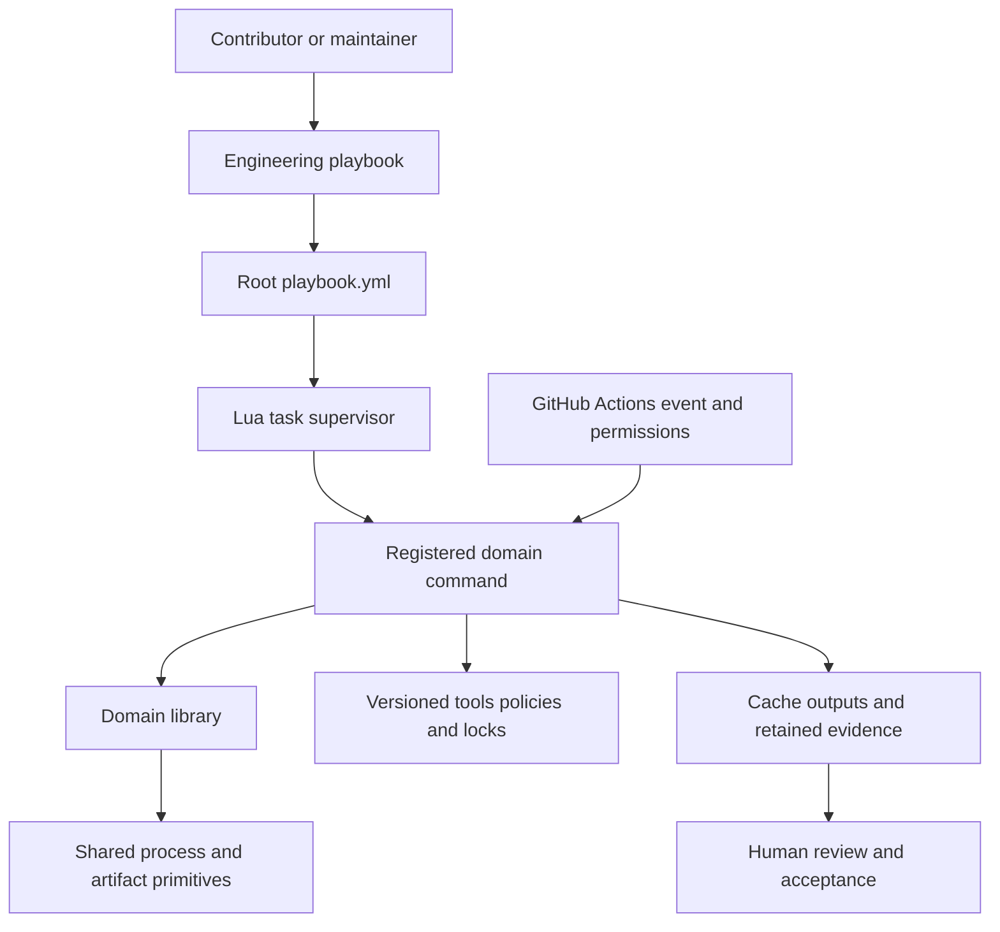

<!--
SPDX-FileCopyrightText: 2026 Rafael V. Volkmer <rafael.v.volkmer@gmail.com>
SPDX-License-Identifier: GPL-3.0-only
-->

# Repository automation

Run commands from the repository root. Choose a domain below, then read the script's introduction and
argument validation. Domain libraries live beside their commands; `lib/` contains shared primitives.
Tool versions belong to [the toolchain lock](../tools/toolchain/lock.toml).

All executable sources in `scripts/` use Lua. Native analysis API adapters live in
`tools/analysis/`; their Lua controllers own invocation and gate outcomes.

| Domain | Responsibility | Start here |
| --- | --- | --- |
| `check/` | Local and hosted verification gates. | `lua scripts/check/all.lua --output=.cache/logs/review` |
| `documentation/` | Doxygen generation, filtering and document policy. | `lua scripts/documentation/main.lua build` |
| `workspace/` | Changed-area selection and disposable workspace state. | `lua scripts/workspace/cache.lua COMMAND [ARGUMENT ...]` |
| `toolchain/` | Resolve versions and provision specific host profiles. | `lua scripts/toolchain/resolve.lua` |
| `build/` | Build matrix, execution and aggregation. | [Build runbook](../docs/runbooks/build.md) |
| `analysis/` | Compiler analysis campaigns and shared evidence context. | [C analysis runbook](../docs/runbooks/c-analysis.md) |
| `qualification/` | Task planning, worker batches and cross-build comparisons. | [Qualification runbook](../docs/runbooks/qualification.md) |
| `github/` | Maintainer-owned specification metadata. | [Specification issues](../docs/procedures/specifications.md) |
| `process/` | Local plan, execution, gate and report phases. | `lua scripts/process/main.lua plan [options]` |
| `security/` | OpenSSF integration planning and adapter reports. | [Security service runbook](../docs/runbooks/security-services.md) |
| `release/` | Construct, sign and verify release artifacts. | [Release fixture runbook](../docs/runbooks/release-fixture.md) |
| `reproducible/` | Independent rebuilds, comparison and diagnostic normalization. | [Reproducibility runbook](../docs/runbooks/reproducibility.md) |
| `lib/` | Paths, host commands, Git, policy and artifact I/O. | Import from a command or domain library. |

Follow the [script layout reference](../docs/reference/script-layout.md) for dependency direction,
compatibility boundaries and historical path migration. Follow the [Lua guides](../docs/standards/lua/README.md)
for implementation contracts. Installation commands can provision host tools; ordinary checks use the
prepared environment and retain outcomes under `.cache/`.

## Directory map

```text
scripts/
├── analysis/          compiler analysis commands and private libraries
├── build/             local build/reconstruction; matrix plan → run → report
├── check/             verification gates; lib/ holds checker-only helpers
├── documentation/     Doxygen driver, filters and document policy
├── github/            specification label reconciliation; lib/ is pure policy
├── lib/               shared paths, processes, Git and artifact I/O
├── process/           evidence phases and the playbook dispatcher
├── qualification/     plans, worker batches, execution and aggregation
├── release/           artifact construction, signing and verification
├── reproducible/      rebuilds, variation and comparison
├── security/          integration planning, execution and reports
├── toolchain/         locked versions and host installation profiles
└── workspace/         caches, change selection, hooks and commit policy
```

The [local build controller](build/local.lua) configures CMake, runs tests and compares installations;
its [reference](../docs/reference/cmake-build.md) defines arguments and assurance limits.

`tools/` holds reviewed policies, tool locks and schemas. The [test architecture](../tests/README.md)
separates automation suites and compiled fixtures. Future formal inputs need a reviewed contract.
`.github/workflows/` chooses hosted events and job permissions. `infra/ansible/playbooks/`
coordinates prepared hosts. Keep a domain helper in its domain's `lib/` until independent callers
need the same contract; move only that shared contract into `scripts/lib/`.

## Execution and ownership



Use `ansible-playbook playbook.yml` to inspect registered commands. The registry in
[tools/process/playbook.lua](../tools/process/playbook.lua) maps tasks to existing entry points.
The `process-ci` task runs plan, execution, gate and report through one portable Lua campaign and emits
[requirement evidence](../docs/reference/evidence.md#requirement-evidence-graph).
The dispatcher preserves arguments and bounds task execution. Each attempt retains separate logs, JSON
and JUnit under `.cache/logs/tasks/`. The registry describes prerequisites, effects and simulation; domain
runbooks retain detailed evidence contracts.
The [native Ansible playbook](../playbook.yml) accepts the same task and an argument list.
Review, issue approval and release authorization remain assigned to people.

Each Lua file has a documented purpose after SPDX metadata and one named initialization function.
Imports, constants, exports and executable statements belong inside functions. A module returns its
constructed API; a command runs its main function. The final returned invocation is the file's bootstrap.
The [Lua checker](check/lua.lua) inspects compiler listings without executing the inspected files.

## Git hooks

The executable adapters in [`.githooks/`](../.githooks/pre-commit) delegate to
[workspace hook orchestration](workspace/lib/hooks.lua), shared reference policy and the CI message validator.
Normal playbook runs include [the versioned Git configuration](../.gitconfig) automatically;
use `ansible-playbook playbook.yml -e lma_task=status` to inspect it.
The installer preserves custom hooks and contributor identity. Read the
[workspace guide](../docs/getting-started/workspace.md) for signing requirements, cache ownership,
optional tools and the pre-push history boundary.

## Source endings

An EOF marker followed by `\n\n` has one terminating newline and one empty line. Keep exactly that final
empty line in marked sources. [The EOF checker](check/eof.lua) rejects missing or extra lines. Formatters may
remove the empty line; [the formatting adapter](check/format.lua) tolerates only this documented difference.

<!-- EOF -->

