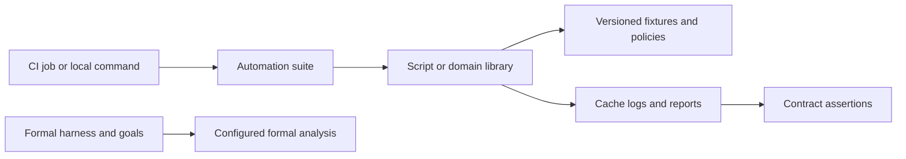

<!--
SPDX-FileCopyrightText: 2026 Rafael V. Volkmer <rafael.v.volkmer@gmail.com>
SPDX-License-Identifier: GPL-3.0-only
-->

# Test architecture

Run suites from the repository root. `automation/` tests the repository's engineering tools;
`fixtures/` supplies compiled and transport inputs. Formal campaigns need reviewed properties before new
harnesses are added.
The current C implementation is a packaging fixture. These suites establish automation behavior,
not completed allocator functionality.

<details>
<summary><strong>On this page</strong></summary>

- [Directory map](#directory-map)
- [Suite ownership](#suite-ownership)
- [Execution and prerequisites](#execution-and-prerequisites)
- [Fixtures and retained evidence](#fixtures-and-retained-evidence)
- [Adding or moving a test](#adding-or-moving-a-test)

</details>

---

## Directory map

```text
tests/
├── automation/
│   ├── analysis/          compiler analysis policy and adapters
│   ├── build/             matrix selection and build evidence I/O
│   ├── check/             C, CI and Lua verification gates
│   ├── documentation/     document policy, Doxygen and browser tools
│   ├── github/            specification-label authority
│   ├── lib/               shared host primitives
│   ├── process/           plans, execution, subjects and evidence
│   ├── qualification/     task graphs, workers and profile reductions
│   ├── release/           inventories, integrity and signatures
│   ├── reproducible/      replica comparisons and normalization tools
│   ├── security/          security service adapters
│   ├── toolchain/         lock parsing and provisioning commands
│   └── workspace/         caches, Git hooks, settings, messages and changed areas
├── fixtures/
│   ├── analysis/          accepted and rejected C scanner inputs
│   ├── compatibility/     C and C++ consumer profiles
│   ├── install/           installed-package consumer project
│   ├── process/           literal argument capture for Ansible
│   └── qualification/     consumer and sanitizer-negative inputs
```

Suite filenames use `<subject>_test.lua`; the browser runtime suite uses `webmcp_test.cjs`.
Keep fixture filenames stable when a tool or format owns their spelling. Generated sources, packages,
logs and reports belong under `.cache/`, outside this source tree.

---

## Suite ownership

Mirror the domain under [scripts/](../scripts/README.md). Test shared host contracts in
`automation/lib/`, installer behavior in `automation/toolchain/`, and Git/cache behavior in
`automation/workspace/`. A suite belongs to the implementation it exercises, even when CI starts it
from a lint job. Documentation policy and Doxygen behavior share one `documentation/` directory.



Mocked ports record arguments and failure outcomes. Integration suites execute the real compiler,
Doxygen, process runner or artifact verifier. Their assertions define what the run establishes;
a successful adapter mock does not establish the behavior of an external service.

---

## Execution and prerequisites

| Scope | Entry point | Prerequisites and boundary |
| --- | --- | --- |
| Lua source quality | `lua scripts/check/lua.lua` | Prepared Lua, compiler, Selene, StyLua and LuaLS; includes initialization-boundary fixtures. |
| Local verification selection | `lua scripts/check/all.lua --output=.cache/logs/review` | Runs its declared gates; unavailable tools count as failures. This is not every campaign. |
| Pure planning contract | `lua tests/automation/build/matrix_test.lua` | Lua and the reviewed build policies. |
| Host provisioning arguments | `lua tests/automation/toolchain/provision_test.lua` | Records installer requests without installing software. |
| Changed-area selection | `lua tests/automation/workspace/changes_test.lua` | Git, Lua and a disposable repository; no remote Git writes. |
| Commit-message links | `lua tests/automation/workspace/commit_links_test.lua` | Real Lychee with offline fixtures; valid links pass and missing targets fail. Runs in the aggregate checker and spelling workflow. |
| Doxygen integration | `lua tests/automation/documentation/driver_test.lua` | Pinned Doxygen and web compiler; full mode also uses the theme and Graphviz. |
| Browser documentation tools | `node tests/automation/documentation/webmcp_test.cjs` | Compiled TypeScript and the integrity-locked documentation DOM dependency. |
| Qualification campaign | `lua tests/automation/qualification/integration_test.lua --output=.cache/qualification/review` | Prepared campaign toolchain and a fresh output directory. |
| Signature integrity | `lua tests/automation/release/signature_test.lua --root=RELEASE_ROOT` | An existing release tree and the configured signing tool. |
| Replica comparison | `lua tests/automation/reproducible/comparison_test.lua --input=REPLICA_INPUT` | A prepared replica input tree with its comparison manifests. |

The C policy and scanner files under `automation/check/` return test functions. Run them through
`lua scripts/check/c.lua`, which supplies their tool ports and executes their assertions.
Running those two modules directly only loads their returned function.

Compile browser sources before their runtime suite:

```sh
node .cache/tools/web/node_modules/typescript/bin/tsc \
  --project tools/lint/code/web/tsconfig.json
node tests/automation/documentation/webmcp_test.cjs
```

A Doxygen build compiles the same sources within its output directory. Set `LIBMEMALLOC_WEB_ASSET`
to that build's `web/webmcp.js` when testing published output. Runbooks describe the prepared environments
for [local checks](../docs/runbooks/local-checks.md), [qualification](../docs/runbooks/qualification.md),
[release artifacts](../docs/runbooks/release-fixture.md) and [reproducibility](../docs/runbooks/reproducibility.md).

---

## Fixtures and retained evidence

CMake reads compatibility inputs from `fixtures/compatibility/`. The install checker copies
`fixtures/install/` into its staging tree. Compiler analysis reads `fixtures/analysis/`; qualification
reads `fixtures/qualification/` and records their digests in its source inventory.

Keep malformed and sanitizer-negative inputs: their expected failures exercise rejection
of invalid behavior. The mock-specific formal harness and ABI campaigns were removed; general
compilation, compatibility and installation fixtures remain active.

Existing cache locations retain their names, including `.cache/tests/doxygen/`. Moving source directories
does not move historical evidence or change external report schemas. Tests that own temporary directories
must release them after success and failure; campaign reports remain available for review.

---

## Adding or moving a test

Identify the owning domain, the contract under test, its prerequisites and the expected failure cases.
Place reusable input data under `fixtures/` and give the suite a purpose statement after SPDX metadata.
Follow the [Lua layout and comment rules](../docs/standards/lua/lua-comments.md).

When moving a suite, update explicit commands, dynamically assembled paths, CI change selection and
source inventories. Verify that Git does not ignore the new location. Update consumer documentation and
run the affected suite through its real entry point. Avoid forwarding scripts and empty compatibility
folders; keep suite ownership aligned with the domain layout above.

Run `ansible-playbook playbook.yml -e lma_task=ansible-test` for the installed controller and its literal-argument
regressions.
This integration requires the pinned Ansible controller and permission to create a local RPC socket.
Use `-e lma_task=hooks-test` for ephemeral-key Git integration and `-e lma_task=process-test` for the four
process controls and evidence-tampering regressions. The traceability suite rejects broken requirement links;
the campaign suite verifies finalization and failure propagation. CI runs these three integrations.

Run `ansible-playbook playbook.yml -e lma_task=tests` for the self-contained automation suites with their listed
dependencies installed.
The runner collects failures and returns a nonzero status. Each suite has a five-minute timeout and
an eight-MiB combined stdout/stderr limit, declared in `tools/testing/suites.lua`; TypeScript compilation
has a separate three-minute timeout. The outer `tests` task retains a one-hour campaign limit.
The runner prints its fresh `.cache/logs/run.*` evidence directory before execution and records each
suite's state, integer elapsed milliseconds, exit code, signal and separate stdout/stderr logs.
`report.json` lists failed and blocked names in catalog order. Spawn errors, timeouts and output-limit
failures remain distinct, and independent suites continue after a failure.

Web suites run only after successful compilation into that invocation's private `web/` directory.
The runner sets their asset paths explicitly; compiler failure marks them BLOCKED without invoking Node
on stale files. Durations and private directory names vary between runs; source selection, execution order
and failure classification are deterministic. Logs remain private under the invocation's owned directory.

 Input-dependent release, qualification and
reproducibility campaigns remain separate. Workspace tests also cover the Git configuration installer,
reference policy, source attributes and ignore rules.

<!-- EOF -->

